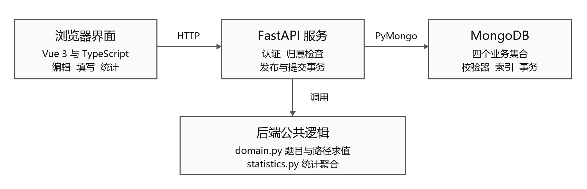
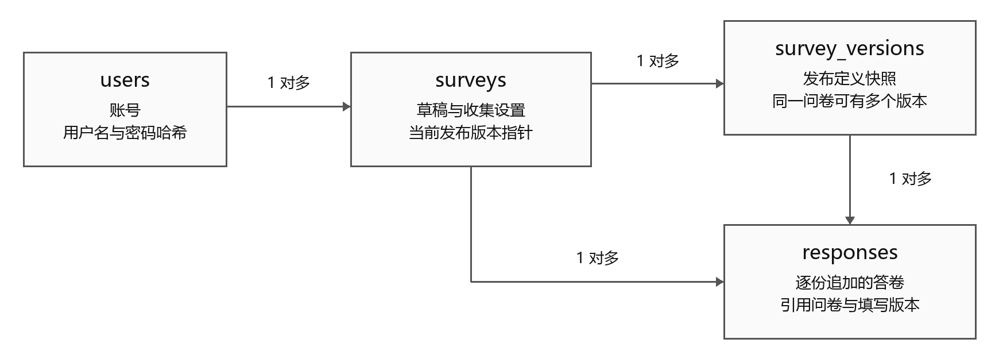

GitHub 仓库：[https://github.com/lingkun-Zhang/ecnu-database-questionnaire](https://github.com/lingkun-Zhang/ecnu-database-questionnaire)

# 基于 MongoDB 的问卷系统实验报告（公开脱敏版）

第一阶段  问川问卷系统

数据库课程实验　华东师范大学　任课教师 周烜

身份信息：公开版本省略，课程提交PDF中保留。

## 一 实验任务与完成情况

这次实验做的是一个基于MongoDB的在线问卷系统。创建者注册后可以编辑、发布问卷，通过链接邀请其他用户填写，再查看统计结果。实验中除了实现这条基本流程，还需要处理题目约束、条件跳转、匿名填写和多人同时提交的问题。

第一阶段实现了单选、多选、文本和数字填空四种题型。题目约束和跳转规则随问卷一起保存，发布时生成版本，答卷记录实际填写的版本。这样，创建者修改问卷后，已有答卷仍能按原来的题目和规则解释。测试除了检查正常填写，还检查了错误输入、重复提交和同时操作的情况。

报告重点说明集合划分、跳转规则、提交处理和统计方法。启动步骤见README.md，接口参数见docs/api.md。

## 二 系统结构与运行环境

### 2.1 功能划分

系统分为创建者和填写者两种使用场景，但共用同一套账号。创建者在工作台编辑草稿、预览跳转、发布版本和查看统计；填写者通过公开链接进入问卷，登录后按当前路径回答。后端对每个管理接口检查问卷归属，其他账号即使知道问卷ID，也不能读取其管理信息和统计明细。

前端使用Vue 3和TypeScript，后端使用FastAPI，通过PyMongo Async访问MongoDB。所有业务数据保存在MongoDB中。前端负责输入和展示，最终是否能够发布、某个答案是否合法、应该走哪条路径，都由后端重新判断。



图1 系统模块与数据访问关系

后端按用途拆分了几个模块：main.py处理接口，services.py组织发布和提交，domain.py负责题目检查与路径计算，database.py和repositories.py处理数据库约束及访问，statistics.py计算统计结果。把规则计算单独放在domain.py中，便于在预览和正式提交时调用同一段逻辑，也方便单独测试。

### 2.2 实测环境与启动方式

| 项目 | 实测版本或配置 |
|---|---|
| 操作系统 | Windows 11 |
| Python与后端框架 | Python 3.12.14，FastAPI 0.147.0 |
| 数据库与驱动 | MongoDB 6.0.29，PyMongo 4.19.0 |
| 前端 | Vue 3.5.22，TypeScript 5.9.3，Vite 7.1.12 |
| Node.js | 24.18.0 |
| MongoDB部署 | 本机单节点副本集rs0，端口27117 |

副本集配置用于支持发布和提交中的多文档事务。源码通过requirements.txt和package-lock.json锁定依赖。安装时运行Install.cmd，启动时运行Start.cmd，浏览器访问http://127.0.0.1:8000；Stop.cmd用于正常停止服务，保留账号和问卷数据。首次运行生成.env配置，后续启动继续使用原配置。

## 三 MongoDB数据库设计

### 3.1 四个集合的划分

数据库分为users、surveys、survey_versions和responses四个集合。划分时主要考虑数据会怎样变化：账号相对稳定，草稿经常修改，发布版本需要保留，而答卷会随填写次数不断增加。

| 集合 | 主要字段 | 保存的内容 |
|---|---|---|
| users | username、usernameKey、passwordHash、createdAt | 账号及登录查找信息 |
| surveys | ownerId、draft、draftRevision、currentVersionId、收集设置、submitSequence | 可编辑草稿和实时管理状态 |
| survey_versions | surveyId、versionNo、definition、publishedAt | 每次发布的完整定义 |
| responses | surveyId、versionId、answers、path、acceptedSeq、acceptedAt | 一次成功提交的答卷 |



图2 四个集合之间的引用关系

surveys通过ownerId关联创建者，通过currentVersionId指向当前发布版本；一个问卷可以有多个历史版本和多份答卷。responses同时保存surveyId和versionId，前者用于问卷范围内管理和限次，后者用于解释答案和按版本统计。MongoDB不会像关系数据库外键那样自动检查这些跨集合关系，因此服务层必须核对归属和版本所属关系。

### 3.2 题目嵌入定义 答卷独立保存

题目、选项、校验参数和跳转规则一起嵌入draft或definition。编辑和填写时通常需要读取整份问卷，把它们放在一起，一次查询就能取得完整定义。问卷题数也有上限，不会像答卷数量那样持续增长。

答卷的增长方式不同。一份问卷可能持续收到提交，如果把所有答卷都放进问卷文档的数组中，文档会不断变大，提交之间也会集中修改同一大文档。因此，每次成功提交在responses中新增一份独立文档，通过ID引用问卷和发布版本。这里仍会更新问卷中的提交序号，但不会把所有答案反复写回问卷文档。

如果按关系数据库的方式把题目、选项和条件逐项拆开，读取整份问卷时就需要关联和组装。这里大多按整份问卷读取，不同题型的配置又不完全相同，用嵌套文档表示更直接。相应地，跨集合的归属和一致性检查需要在服务层完成，涉及多条记录的操作使用事务。

### 3.3 草稿与发布版本分开

草稿可以反复编辑，也允许暂时没有题目。发布则要求题型、选项、约束和跳转检查全部通过，并把完整定义写入survey_versions。之后修改草稿不会修改已经发布的版本。

例如，V1中某个数字题允许0到100，已有用户提交90。如果创建者随后把上限改成80并发布V2，原来90的答卷仍应按V1解释。若答卷只关联当前草稿，历史答案会被新规则误判为不合法。保存发布快照虽然会重复一些题目内容，但这种冗余换来了明确的历史含义。

每个题目、选项和规则都有稳定ID，移动题目或修改显示文字不会直接改变ID。显示顺序和跳转目标也分开保存，跳转不依赖“数组里的第几个元素”。历史版本仅提供读取和复制入口，现有接口不会原地改写它的定义。

### 3.4 答卷如何表达跳过和未答

答卷主要保存answers和path两部分。path记录实际到达的题目，answers只保存已到达、通过校验且有值的答案。下面是说明结构的片段，省略了其他必需字段：

```json
{
  "surveyId": "s1",
  "versionId": "v1",
  "path": ["q_age", "q_minor", "q_hobby", "q_score"],
  "answers": [
    {"questionId": "q_age", "kind": "number", "value": 17},
    {"questionId": "q_hobby", "kind": "multi", "value": ["read"]},
    {"questionId": "q_score", "kind": "number", "value": 0}
  ]
}
```

在这个例子中，q_minor出现在path中但没有答案，表示到达后未答；成年身份题不在path中，表示被跳过。这两种情况在统计时分别处理。评分0是有效答案，不能用“值是否为真”来判断它有没有填写。

填写者回改前面的答案后，原分支的输入可能仍留在页面缓存里。提交时后端从入口重新求值，只保存新路径上的有效答案。页面传来的旧值不能直接进入数据库和统计。

### 3.5 校验器 索引与必要冗余

四个集合都使用strict/error校验器，限制必要字段、对象结构和BSON类型。responses进一步限制各题型的答案类型，检查题目ID不重复、答案题目属于path，以及匿名答卷不含identity。数据库层的检查可以挡住绕过HTTP直接写入的部分非法数据。

账号另外保存规范化的usernameKey用于查找和唯一性判断，避免大小写等价的用户名被重复注册。并发注册时由唯一索引作最终约束，不能先查一次“用户名不存在”就认为后续插入一定安全。

校验器不读取发布版本，所以不能单独判断选项是否属于本题、答案是否满足本题范围、路径是否由正确规则生成。这些属于随问卷配置变化的业务校验，放在领域层和服务层。数据库约束与业务校验的作用不同，两者都保留。

| 索引位置 | 键 | 用途 |
|---|---|---|
| users | usernameKey唯一 | 登录查找及并发重复注册约束 |
| surveys | publicId唯一；ownerId、createdAt、_id复合索引 | 公开链接查找及本人问卷列表排序 |
| survey_versions | surveyId、versionNo唯一；surveyId、publishKey唯一 | 版本编号及发布重试 |
| responses | surveyId、participantKey、submissionKey唯一 | 同一次提交只保存一份 |
| responses | surveyId、oneTimeParticipantKey部分唯一 | 不允许重复填写时的参与限制 |
| responses | surveyId、acceptedSeq唯一；surveyId、versionId、acceptedSeq复合索引 | 提交序号、固定范围查询及分页 |

允许多填时不保存oneTimeParticipantKey；禁止多填时，由服务端生成该字段，部分唯一索引才会约束它。这个字段不能由填写者决定是否携带。索引的实际读取效果见第八节。

问卷保存currentVersionId，便于找到当前发布版本；实名答卷保存提交时的用户名，避免以后改名影响历史显示。统计总数和均值直接从答卷聚合，没有另外维护一份统计副本，减少答卷和统计同时更新的麻烦。

## 四 跳转与校验的实现

### 4.1 跳转规则保存为数据

每道题保存defaultTarget和rules。没有命中规则时走defaultTarget，命中规则时走对应target，终点统一用END表示。单选可按选项ID判断；多选支持包含任一、包含全部、集合相同；数字支持大小比较、相等和闭区间。allOf与anyOf用于组合同一道题的条件，当前不支持任意跨题表达式。

以年龄题为例，默认去身份题，另配置“小于18时去兴趣题”。17岁会跳过身份，18岁进入身份。程序读取的是保存在问卷中的条件值和目标ID，并没有把“18岁”写成所有问卷共用的业务判断。

一题可以有多条规则，priority越小越先检查，首次命中后就停止。这样即使两个条件重叠，执行去向仍然确定。创建者预览可以看到实际检查的规则和命中的目标。

下面是一道身份单选题保存在questions数组中的定义。student和worker是选项ID，q_study和q_work分别是后续“学习情况”和“工作情况”两道题，回答后都结束问卷。

```json
{
  "id": "q_identity", "kind": "single",
  "title": "你的身份", "required": true,
  "config": {"options": [
    {"id": "student", "label": "学生"},
    {"id": "worker", "label": "工作人士"}
  ]},
  "defaultTarget": "q_work",
  "rules": [{"id": "r_student", "priority": 10,
    "condition": {"operator": "eqOption", "value": "student"},
    "target": "q_study"}]
}
```

多选例子使用另一份小问卷，兴趣题有阅读read、运动sport、音乐music三个选项，要求选1到2项。配置两条规则：优先级10表示同时包含read和sport时进入“综合活动”，优先级20表示包含read时进入“阅读习惯”，其他情况默认进入“其他兴趣”。两条规则的operator分别为containsAll和containsAny，value分别为["read","sport"]和["read"]。

| 配置与输入 | 命中情况 | 实际去向 |
|---|---|---|
| 身份选student | eqOption命中 | 身份→学习情况→结束 |
| 身份选worker | 未命中，采用默认去向 | 身份→工作情况→结束 |
| 兴趣选read和sport | 两条规则都满足，优先执行10 | 兴趣→综合活动→结束 |
| 兴趣先选sport再选read | 与上一行等价 | 兴趣→综合活动→结束 |
| 兴趣只选read | 10不满足，20命中 | 兴趣→阅读习惯→结束 |
| 兴趣只选music | 两条规则都不满足 | 兴趣→其他兴趣→结束 |
| 兴趣选read和music | 10不满足，20命中 | 兴趣→阅读习惯→结束 |
| 兴趣三个选项全选 | 先违反最多2项的限制 | 返回数量错误，不允许提交 |

表中8组输入调用了定义检查和路径求值函数，结果与预期一致。这里可以看到，多选答案的排列顺序不影响去向；选择数量超出限制时，会先报错，不再继续匹配跳转规则。第七节的六份样例则用于检查统计结果。

### 4.2 先检查定义 再执行路径

发布前把每道题看作节点，把默认去向和条件去向都看作有向边，检查目标是否存在、ID是否重复以及完整图是否有环。检查包含暂时不可达的部分，避免以后调整入口后才暴露循环。只要完整图无环，目标题号在前面也不必一律拒绝。

定义合法以后，求值过程可以概括为：

```text
从入口题开始
读取并规范化当前答案
按题目配置校验
对合法且非缺失的答案按优先级检查规则
命中则去规则目标 否则去默认目标
重复直到END或出现当前填写错误
```

创建者预览、填写中的实时求值和最终提交共用domain.py的核心逻辑。实时填写停在当前待答或错误题；正式提交必须完成路径且没有错误。这样可以避免预览通过、提交时却按另一套条件执行。

系统还提供不可达题、重复条件、部分无解或被前规则遮蔽等提示。创建者可以据此调整配置；合法条件发生重叠时，仍按优先级执行。

### 4.3 不同题型的校验

| 题型 | 主要校验 | 规范化或边界处理 |
|---|---|---|
| 单选 | 必答、选项属于本题 | 保存选项ID，不使用显示文字作标识 |
| 多选 | 选项归属、不重复、最少和最多数量 | 按ID排序；恰好N项用上下界均为N表达 |
| 文本 | 必答、最短和最长长度 | 去首尾空白后校验并保存 |
| 数字 | 必答、上下界、是否为整数 | 0有效；拒绝布尔值和数字字符串；18.0可规范为整数18 |

选填题缺失时允许跳过约束检查，并沿默认边继续；一旦填写了非缺失值，就仍须满足范围或长度要求。前端做即时反馈，服务端始终重新校验，不能依赖输入框的属性保证安全。

## 五 保存 发布和提交的一致性

### 5.1 防止旧页面覆盖新编辑

保存草稿时携带expectedDraftRevision。数据库更新条件同时检查问卷归属和当前修订号，匹配才保存并增加修订号。两个页面打开同一草稿时，先保存的一方改变修订号，后保存的旧页面会收到冲突，不能无条件覆盖前一次修改。收集设置使用单独的settingsRevision，避免把内容编辑和截止时间修改混成同一个修订。

发布使用事务，同时完成“插入新版本”和“切换当前版本指针”。事务中重新检查草稿修订及预期当前版本；发生冲突时回滚，不留下孤立版本或指向不存在版本的问卷。已有填写凭据绑定开始时的版本，因此发布V2不会把已开始的V1填写强行换到新规则。

### 5.2 重复请求与重复填写分开处理

重复请求是网络重试或重复点击造成的同一次操作，重复填写则是同一个人再次提交一份答卷。系统分别处理这两个问题。

同一次提交携带固定的Idempotency-Key。后端对版本、匿名选择和规范化有效答案计算摘要：键和内容都相同，就返回原回执；同一个键改了有效内容，就返回冲突，不覆盖已经保存的答卷。多选顺序、整数的等价表示等会先规范化，避免把同样的有效答案误认为不同内容。已经成功的请求在问卷后来关闭后仍可恢复回执，但不能据此新增答卷。

是否允许同人多填由问卷设置决定。服务端在事务中读取实时政策，禁止多填时生成一次性参与字段，再由部分唯一索引约束。账号相同但提交键不同，不会自动绕过限次规则。

### 5.3 提交与关闭如何协调

如果提交请求先查询“问卷开放”，再单独插入答卷，中间可能发生创建者关闭问卷的操作，这个请求仍会按旧状态写入。即使把读取和插入放进快照事务，只要关闭和提交没有修改同一条记录，也不能据此确定二者的先后。

因此，提交事务先更新surveys中的协调记录，增加submitSequence并锁定多填政策。关闭和设置修改也更新这条记录，发生竞争时，由MongoDB写冲突和事务重试协调。提交取得协调记录后，再读取服务端时间作为acceptedAt，检查关闭和截止要求，最后插入答卷。截止判断以这次接受时间为准。

失败事务会一起回滚答卷、序号和政策锁。首次成功提交后，多填政策锁定，防止已有答卷产生后再随意改变限次含义。截止时间等允许修改的设置仍按各自规则处理。

这种做法也有代价：同一问卷的提交需要更新同一条管理记录，高并发时会产生竞争。第一阶段采用这个方案，主要是让提交、关闭和限次之间的先后关系明确。以后提高并发能力时，还需要结合写入测试调整。

### 5.4 匿名与管理权限

匿名填写仍要求登录。匿名表示问卷创建者看不到填写者身份，不表示系统完全无法关联账号。服务端使用问卷范围内的HMAC参与标识计算人数和执行限次，管理接口不返回这个内部标识。

匿名答卷不保存identity；实名答卷保存提交时身份显示信息。查询和CSV都按同一匿名规则输出，内部摘要、参与标识和原始用户ID不直接交给管理端。密码使用Argon2哈希保存，管理接口在后端核验ownerId，而不依赖前端隐藏按钮。

## 六 统计结果如何计算

统计通过MongoDB聚合完成。首先按问卷、版本和已接受序号范围筛选答卷，再分别计算总份数、参与人数、到达题目、有效答案、选项次数和数字结果。需要查看文本原文或数字原始值时，通过答卷明细分页读取。

题目有跳转后，未答不能只用“总份数减有效数”解释。系统区分R为范围内答卷总数，V为到达本题的份数，A为有效回答份数，U为到达后未答份数，S为被跳过份数，并核对V=A+U、R=A+U+S。例如一共有6份答卷，其中3份走成年身份题，另外3份被跳过；成年题有效回答3份，不能把另外3份当成漏填。

允许重复填写时，答卷份数和独立参与人数也不同。选项统计保留选择次数和独立参与人数两个口径，避免把同一个人的两次填写当成两个人。数字平均值只计算实际有效的答案，包含0，不包含缺失值；多选则展开每个选项分别计数。

统计首次读取时取得asOfSeq，后续分页和导出继续使用这个序号边界。比如先统计到第45份，此后新增第46份，原来的下一页仍只属于前45份，刷新统计后才纳入第46份。前提是当前正式答卷只追加，系统没有提供改写历史答卷或删除答卷的接口。

## 七 功能测试与结果

### 7.1 核心流程的实际操作

功能测试从一份空白问卷开始，依次添加年龄、身份、兴趣和建议四道题。年龄限制为0到120的整数，兴趣要求恰好选2项，建议长度为2到20字；年龄小于18时跳过身份题。保存后刷新页面重新打开，检查配置仍在，再发布V1。

| 测试内容 | 输入和步骤 | 预期与实际结果 |
|---|---|---|
| 创建与加题 | 创建标题和说明，逐项添加四种题型，保存后重新打开 | 题目、选项和约束保留，通过 |
| 数字约束 | 年龄填121，再改为17 | 121被拒绝，17可继续，通过 |
| 条件跳转 | 分别填写17和18 | 17跳过身份，18进入身份，通过 |
| 多选数量 | 兴趣只选阅读，再加选运动 | 一项被拒绝，两项可继续，通过 |
| 文本长度 | 建议填“好”，再改为“很好” | 一字被拒绝，两字可继续，通过 |
| 正式提交与统计 | 匿名17岁提交；再次实名18岁、身份学生提交 | 保存两份答卷，统计与下面核算一致，通过 |

两次填写使用同一个测试账号，所以结果应为2份答卷、1位参与者，其中1份匿名。年龄总和35，平均17.5；身份题到达1份、跳过1份，学生选项出现1次；阅读和运动各2次；建议分别为“很好”和“增加实践机会”。页面上的整卷统计和单题明细与这些值一致。

### 7.2 六份教学样例核算

另外使用六份合成答卷核对统计。同一参与者A填写两次，其余B、C、D、E各一次；这些样例与上一节的两份页面答卷属于不同问卷。

| 序号 | 参与者 | 匿名 | 年龄 | 身份或学习活动 | 兴趣 | 评分 |
|---|---|---|---:|---|---|---:|
| 1 | A | 是 | 17 | 学生 | 阅读 运动 | 0 |
| 2 | B | 否 | 18 | 学生 | 阅读 | 8 |
| 3 | C | 是 | 20 | 工作人士 | 运动 音乐 | 6 |
| 4 | D | 否 | 16 | 未答 | 音乐 | 未答 |
| 5 | A | 是 | 18 | 学生 | 阅读 音乐 | 10 |
| 6 | E | 否 | 12 | 参加兴趣班 | 运动 | 4 |

按表计算，共有6份答卷、5位参与者，匿名和实名各3份。成年身份题到达3份，学生2份、工作人士1份；阅读、运动、音乐各出现3次。评分有效5份，总和为0+8+6+10+4=28，平均5.6。未成年人活动题到达3份，其中2份有效、1份未答。MongoDB聚合及接口返回的结果与这些计算一致。

### 7.3 自动回归与边界检查

| 验证项目 | 实际结果 |
|---|---|
| 最终完整后端回归 | 162项通过，251个subtest通过，3项跳过，用时42.32秒 |
| 前端条件编辑 会话与错误定位 | 58项通过（10月22日） |
| 前端类型检查与生产构建 | 通过 |
| 新目录安装与连续页面流程 | 通过，使用新配置和独立测试库 |
| 原演示数据和配置保护 | 四集合全文摘要及.env摘要前后一致 |

后端结果来自10月21日的测试，3项跳过与Windows符号链接权限有关，251个subtest单独计数。10月22日修复编辑器等待时仍可输入的问题后，前端58项测试通过，包含新增的15项保存、发布和账号切换检查。测试日志和页面截图保存在docs/evidence中。

并发与边界用例还检查了：相同提交键并发只保存一次；同键换有效内容被拒绝；多填政策和首次提交发生竞争时结果一致；关闭或跨过截止后拒绝新提交；发布冲突不留下孤立版本；固定统计范围后追加答卷不会混入旧分页。集合约束专项另执行237次非法插入、替换或更新，均被校验器拒绝。

另外在本机新目录中重新安装依赖、生成配置并构建前端，使用独立数据库完成创建、填写和查看统计的流程，确认项目不依赖原来的测试数据。

## 八 索引执行计划实验

### 8.1 实验方法

为了检查索引是否能用上，另外建立测试库，生成1,000份问卷、2,000个版本和20,000份合成答卷。测试库使用与应用相同的校验器和索引，答案根据前面的六份样例生成并经过规则计算后批量写入。

选取所有者列表、幂等回执、游标页、完整统计和匿名统计五类真实查询，比较不指定hint的默认计划、指定现有索引、用自然顺序hint强制全扫三种方式。每种方式保留完整executionStats，预热一次后交错运行7次实际查询。每次核对返回结果，列表保留次序，聚合只对无序分组数组做规范排序后比较。

### 8.2 扫描数量与耗时

| 查询 | 默认检查文档 | 全扫检查文档 | 默认耗时中位数 ms | 全扫耗时中位数 ms |
|---|---:|---:|---:|---:|
| 所有者首页30份 | 30 | 1,000 | 2.5384 | 3.7168 |
| 同一次提交回执 | 1 | 3,821 | 0.9792 | 4.6324 |
| 答卷游标页30加1 | 31 | 20,000 | 2.0519 | 19.6000 |
| 版本范围完整统计 | 80 | 20,000 | 6.6719 | 24.4725 |
| 同范围匿名统计 | 80 | 20,000 | 4.9506 | 23.8270 |

五类查询三种方式的结果一致，默认计划都自行命中设计索引。列表和答卷页的索引还避免了阻塞排序。幂等回执全扫在第3,821份文档找到目标后，因limit1提前停止。

匿名统计读取版本范围内80份答卷，再筛成40份进入聚合，说明anonymous仍是读取文档后的过滤条件。当前先保留已有索引，避免增加一套写入维护开销；如果以后匿名筛选成为主要查询，再比较新增索引的读写成本。

表中的耗时取预热后7次查询的中位数，包含读取和解码时间。与全扫相比，现有索引减少了需要检查的文档，答卷分页和版本统计的差别比较明显。执行计划及实验步骤见docs/index-experiment.md。这里测的是读取查询，还不能据此判断多人同时提交时的性能。

## 九 AI辅助开发与问题处理

### 9.1 工具使用与方案调整

本次实验使用Codex辅助整理资料、讨论方案、生成代码、调试和测试，也借助它整理报告。开始时，我要求先阅读相关资料、设计大纲，再按模块推进。开发过程中，根据阶段结果提出调整意见，包括前端样式过于花哨、报告对设计原因解释不够具体等问题。

| 提出的要求或反馈 | AI辅助产出 | 调整结果 |
|---|---|---|
| “还是参考一些资料哦，先设计一下大纲” | 功能划分、数据组织及实现建议 | 先明确大纲，再分步实现 |
| “继续，我觉得你的前端做的AI味有点重，要不要先改一下” | App.vue、DefinitionEditor.vue和style.css | 去掉宣传装饰，改为问卷列表并精简页面文案 |
| “你回忆一下评分点，不要太去内卷细节，主要看打分点” | 需求核对、设计解释及报告初稿 | 把精力放回数据库、核心逻辑和报告 |

发布快照、事务协调和固定范围统计在AI辅助形成的V4设计稿中已有约定，后续在实现和测试中完善。它们分别处理历史答卷、提交与关闭的先后关系，以及统计分页的一致性。我的要求和调整体现在项目安排与使用效果上：先看资料和大纲、分步推进、修改前端风格，后期按评分点优先完善数据库设计、必要测试和报告。对应的提示、代码产出和调整记录见docs/ai-use-summary.md及docs/ai-log.md。

### 9.2 两处具体问题的修正

调试时遇到过MongoDB读回的整数被误判为非法的问题。原因是最初的类型判断没有兼容BSON Int64。修改后接受这种合法整数，同时仍拒绝布尔值，并增加BSON编码、解码回归测试，避免只用普通JSON数字时遗漏这个问题。

另一处问题在组合条件编辑中：把“且”改成“或”时，原有子条件被重置了。后续借助AI修改转换逻辑，保留子条件的数值和嵌套结构，再检查保存、刷新重开及预览结果，并补充对应的回归测试。

这两处问题在代码能运行时仍然会出现，所以检查不能停在编译通过。测试中还需要对照具体答案、数据库文档和页面结果，例如六份答卷的平均分应为5.6，年龄17和18应进入不同路径。

### 9.3 反馈带来的修改与日志附件

例如，前端修改来自我对页面风格的反馈：原来的宣传横幅和装饰较多，调整后以问卷列表和编辑操作为主，具体页面代码由Codex协助修改。附带的docs/ai-use-summary.md把主要提示、产出文件、设计来源和修改结果列在一起；docs/ai-log.md按日期保留各轮记录，其中用户提示与AI内部任务提示分别标注。代码检查中发现的技术问题及修正也单独记录，便于与本节说明对照。

## 十 实验小结与后续改进

这次实验中，集合划分主要围绕问卷的实际使用方式展开：题目和规则一起读取，答卷逐份增加，发布版本需要保留。这样的划分既方便读取完整问卷，也能让修改前后的答案分别对应自己的版本。预览和提交共用规则计算，则减少了两处实现不一致的问题。

第二阶段需要在此基础上修改。以未来可能增加日期题为例，四个业务集合可以继续保留，但需要补充领域层的日期配置和答案校验、数据库允许的题型与答案结构、前端编辑和填写控件，以及统计展示。若日期题也允许条件跳转，还需要增加对应的条件运算。现有四类题型的处理逻辑和测试继续保留，用来核对旧问卷仍能运行。

增加题型时，新草稿和新发布版本可以采用新配置，原版本及答卷仍保留原versionId。schemaVersion目前只标记数据格式；如果以后改变已有字段的含义，还需要补充格式识别和迁移，不能只改这个编号。

目前还有需要改进的地方。同一问卷的提交会竞争管理记录，单节点部署也不适合直接用于较大规模的实际服务。后续应补充更大规模的并发写入负载实验，再根据结果调整提交处理和部署方式。
