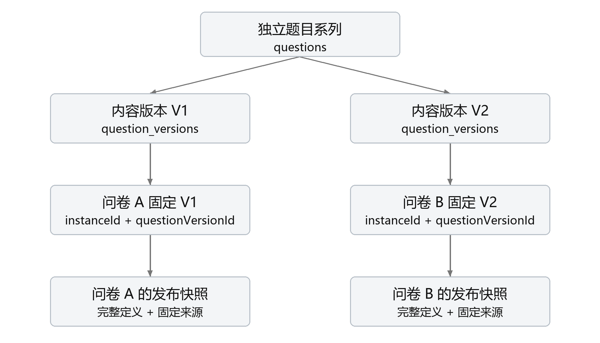

# 问川第二阶段项目完成报告

## 一 项目概述

问川是基于MongoDB的问卷系统，后端采用Python与FastAPI，前端采用Vue与TypeScript。第一阶段已经支持注册登录、问卷编辑、四种题型、条件跳转、校验、发布、填写提交、统计和原始回答查看。第二阶段围绕常用题目重复使用这一实际问题，在原系统上增加独立题目、题目内容版本、共享使用、题库、引用查询和跨问卷单题统计。目标是让题目能够独立演化，同时继续准确解释已经发布的问卷和已经接收的答卷。

本阶段保留了原有问卷执行定义、发布快照、答卷存储和求值引擎。主要调整是把题目的长期身份、不可变内容版本与问卷内的使用实例分开，再以明确来源关联三者。问卷仍保存完整可执行定义，填写时不临时读取题库最新版；编辑原题、恢复旧内容、更新题库成员也不会自动替换已经保存的问卷引用。原系统的跳转、校验、幂等提交和单卷统计继续使用，新增功能通过原保存、发布和提交链路接受验证。

实现以第一阶段提交`99b66d1e637fa3b4ecb13719c0230ecb7e958701`为可追溯基线，采用连续本地提交逐步扩展。当前业务模型有十二个MongoDB集合，接口快照有四十七项操作、四十条路径。10月29日最新完整验证批次为后端502项通过、三项Windows权限相关跳过，251个子测试通过；前端216项通过，类型检查和生产构建通过。测试数量按各自批次记录，不把子测试、历史批次和浏览器检查点合并成一个通过总数。[E14]

项目还用真实第一阶段代码创建数据，在四个归属明确的隔离副本中完成升级、旧程序处理混合数据的边界检查、重新启用当前程序和升级前备份恢复。结果证明新程序可以保留旧数据及主要行为，也说明直接将旧程序接到第二阶段混合库并不是可用回退方式。演练没有接触真实业务库，原始备份、临时凭据和运行截图保持私有，本阶段没有自动推送远端或向课程平台提交。[E02]

## 二 第一阶段设计与需求变化

### 第一阶段的结构

第一阶段将业务组织为用户、问卷、发布版本和答卷四个集合。问卷主记录保存当前草稿、所有者、收集设置及当前发布指针；草稿中的题目包含题型、内容、约束、必答标记、默认去向和条件规则。发布时生成完整快照，答卷通过发布版本标识解释，避免后来修改草稿改变历史答案的含义。答卷独立存储，能够持续增长，不会无限嵌入问卷文档。

草稿修订与收集设置修订分开管理。保存草稿检查预期修订，发布检查草稿修订和预期当前发布版本。填写凭据绑定开始填写时的具体版本；新版本发布后，已经取得的旧凭据仍按原版求值和提交。提交事务同时协调问卷状态、接收序号、重复填写限制与答卷写入，保证关闭、截止或写入失败时不留下半份成功结果。以上机制构成第二阶段可沿用的基础。

### 原设计面临的新矛盾

最初的题目只属于一份问卷，其局部标识只保证卷内唯一。把相同文字复制到另一份问卷，并不能证明它们是同一道题，也不能知道新题从哪一版修改而来。整卷发布版本虽然能保护历史问卷，却不能直接提供独立题目的历史、共享和题库管理。若让多个问卷实时指向同一份可变题目，又会使作者的一次修改改变旧问卷内容，破坏原来已经解决的历史解释问题。

题目内容与问卷流程也存在不同的变化范围。年龄题的文字、数值上下界和整数要求可以重复使用，但必答要求、题目顺序以及跳转目标属于具体问卷。把完整卷内题目直接保存为通用题目，会带入原问卷的目标标识和规则，产生不存在的跳转或不恰当的流程。第二阶段因此复用内容和约束，把实例级必答、默认边与条件边留在问卷中设置。

共享和统计又提出新的权限问题。允许某人使用题目，不代表允许其修改原题，更不代表允许作者查看对方收集的全部答卷。使用情况查询需要解释引用关系，跨问卷统计需要计算回答，两者的数据范围和输出粒度不同。因此不能通过放宽原问卷所有者检查来实现新需求，也不能仅在页面隐藏入口而保留可以越权调用的后端接口。

## 三 新需求的落实与业务解释

任务书新增八项用户需求。本阶段按用户实际操作组织实现，不以集合数量或界面复杂度代替需求完成情况。

| 需求 | 对应实现 | 关键验证 |
|---|---|---|
| 保存并重复使用题目 | 独立题目及内容版本 问卷显式选版 | 多卷引用同版及四题型保存 |
| 共享给其他用户 | 指定账号的系列使用授权 | 接收者选题 越权拒绝 撤销竞争 |
| 修改不影响旧问卷 | 不可变内容版本及发布快照 | 旧定义 旧凭据 旧答卷解释 |
| 记录历史和恢复 | 父版本及恢复操作元数据 | 基于旧版派生 恢复生成新版 |
| 不同版本同时存在 | 各问卷固定具体版本 | A用旧版 B用新版 |
| 查询使用并决定修改 | 本人使用查询 作者影响检查 | 引用条目 确认与取消 |
| 管理题库 | 私有库及固定版本成员 | 收录 换版 移除 归档恢复 |
| 跨问卷单题统计 | 固定来源范围及分版聚合 | 数值分布 明细与权限隔离 |

部分原文没有规定细节，需要明确采用的解释。其一，所有已经保存的内容版本都保留，修改和恢复通过新增版本表达；不创建新版意味着取消本次检查或编辑，不表示覆盖已发布内容。其二，共享按题目系列授予使用权，接收者可以选择历史和后续版本，但每次使用仍固定到具体版本。其三，撤销后，服务器当前草稿已经保存的同一固定绑定可以继续使用，新增实例、换版或复制到新问卷需要重新具备权限。这项撤销策略由用户明确确认。

对于跨用户统计，采用用户确认的规则：本人的问卷自动纳入，其他问卷由其所有者单独向题目作者授权汇总；题目共享本身不授予答卷权限。对于修改影响，作者看到本人问卷标题和他人问卷的稳定脱敏引用代号，能够区分实际引用条目，但不能通过该入口获得对方真实标题、身份或填写链接。这是保护私有问卷采用的解释，不是任务书指定的展示字段。跨问卷统计按内容版本分别解释，不将不同题型、选项含义或数值约束的版本直接混算。[E03]

## 四 数据模型与身份划分

### 三种题目标识

独立题目身份表示同一题目的版本系列，承担所有权、共享和历史入口。内容版本身份表示某一份已经保存的题干、题型及约束，承担固定复用和统计解释。卷内实例身份表示该题在一份问卷中的一次出现，承担路径、答案和实例级设置。同一道题可以在一份问卷中出现多次，因此不能拿内容版本标识代替卷内实例标识。

来源映射包含`instanceId`、`questionId`和`questionVersionId`。草稿通过可选的`draftQuestionSources`记录绑定，发布快照通过可选的`questionSources`冻结绑定。来源放在执行定义之外，使原领域引擎继续接收已经验证过的完整题目定义。没有来源的第一阶段问卷仍是合法旧格式；系统不会根据相同题干、选项或局部标识自动给它们补上独立身份。[E04]

图1为结构示意。题目系列连接内容版本，问卷内的实例固定引用其中一版；问卷发布时同时冻结完整定义和来源。图中的连接表示身份与使用关系，不表示作者创建新版后会自动传播内容。

### 问卷执行域

| 集合 | 核心内容 | 生命周期与理由 |
|---|---|---|
| users | 用户名口令摘要和注册时间 | 账号独立存在 |
| surveys | 草稿 修订 设置 当前发布指针 | 当前可变状态集中管理 |
| survey_versions | 完整执行定义 发布信息 来源 | 每次发布追加快照 |
| responses | 发布版本 路径 答案 接收序号 | 提交记录独立增长 |

问卷中的题目和规则继续嵌入草稿及快照。每份定义有题目数、规则数和大小上限，且求值通常需要整体读取，嵌入能够让一次读取获得相互关联的执行内容。答卷则具有持续增长、分页和独立统计需求，所以不嵌入问卷。来源与完整内容同时保存是有目的的冗余：来源说明题目身份，快照负责长期解释；写入时校验两者一致，避免只有引用却无法重现当时内容。

### 题目管理域

| 集合 | 核心内容 | 主要职责 |
|---|---|---|
| questions | 所有者 当前版本 最后编号 创建键 | 系列身份和当前头 |
| question_versions | 所属题 父版本 内容 请求摘要 | 追加内容历史及恢复记录 |
| question_shares | 双方账号 有效状态 修订 协调序号 | 独立可撤销的使用授权 |
| question_banks | 名称 说明 归档状态 统一修订 | 私有题库管理 |
| question_bank_items | 题库 题目 固定内容版本 | 可独立增长的成员关系 |

题目版本仅保存`kind`、`title`和`config`。首次版本没有父版本；派生版本必须引用同一题目的已有父版本。版本号表示创建顺序，父版本表示内容来源。例如当前为V2时仍可基于V1创建V3，因此历史不能被误画为只能相邻修改的单链。恢复还保存操作类型和恢复前当前版本，说明取回哪份内容、从什么状态发起恢复；旧版本缺少这组元数据时保持缺失，不反推不存在的操作。[E12]

共享接收者和题库成员分别存储，避免把无限增长的数组写进题目或题库主文档。题库成员固定一个具体版本，作者后来生成新版不会自动更新成员；显式换版只改变题库选择，不替换已经用于问卷的来源。成员被移除时，独立题目、历史问卷和答卷仍存在。私有题库是组织方式，不是新的权限授予工具，收录他人题目也不能绕过共享检查。[E05]

### 统计范围域

| 集合 | 核心内容 | 有效期与作用 |
|---|---|---|
| question_stat_scopes | 查看者 筛选 创建摘要 数量 | 查询有效三十分钟 |
| question_stat_sources | 发布来源 各卷序号 权限修订 | 固定本次统计边界 |
| question_stat_grants | 问卷 题目 接收者 有效修订 | 单独授予汇总权限 |

范围根保存查看者内部账号引用、题目及版本筛选、匿名或实名筛选、创建键与摘要、来源数量和时间。来源子记录保存具体问卷、发布版本、该问卷的序号上界及访问模式；他人来源还保存授权标识和修订。它们不复制答案或填写者身份，公开响应也不返回创建键、摘要和查看者标识。范围过期后不能继续读取，根的创建回执延后保留七天，支持有限时间内的原请求恢复；来源子记录按三十分钟有效期回收。[E06]

## 五 MongoDB约束与索引设计

### 结构约束与业务约束分工

初始化为各集合建立严格BSON校验器，检查必要字段、未知字段、类型、编号及有界内容。不同题型的内容结构分别约束，例如选择题必须带选项，数字题包含数值界限及整数标记，不能把题型不相干字段任意混入。恢复元数据要求成对出现；他人统计来源必须同时具有授权标识和授权修订，本人来源则不带这组字段。[E11]

这些约束不能代替跨文档和领域判断。版本是否属于当前题目、调用者是否是所有者、来源内容是否一致、跳转目标是否存在，都由服务层和领域引擎核对。数据库校验器也不能阻止具有数据库管理权限的人把一份合法文档改成另一份合法文档。不可变性依靠应用没有更新或删除历史版本的入口、所有权检查、追加写入协议及测试保障，而非宣称普通校验器能够独自实现绝对不可改写。

新增集合的`schemaVersion=1`表示各自文档格式的首版，不等于课程阶段编号。旧四集合不被批量改成第二版，旧来源字段继续可选。初始化创建或更新契约与索引，不删除业务集合，不把不合法历史数据悄悄修复成当前形状；约束或索引冲突应作为需要核对的问题暴露，而不是通过丢弃数据让启动成功。

### 索引围绕实际读写建立

唯一索引用于守住业务身份：题目按所有者与创建键唯一，内容版本按题目与版本号、题目与请求键唯一，共享按题目与接收者唯一，题库成员按题库与题目唯一。统计来源在同一范围和发布版本下唯一，汇总授权在同一问卷和题目下唯一。这些约束与事务配合，避免并发重试产生重复实体或同一编号的两个版本。

列表索引按所有者、状态和排序字段组织，历史版本依题目及版本号读取。使用查询分别支持题目系列与具体版本，并把题目和版本条件放在同一来源元素中。系列查询与精确版本查询的等值前缀不同，不能因为字段相近就认为一个索引能够替代两种排序需求。发布来源查询还需要关联真实问卷检查所有者，不能把索引减少候选读取描述成已经覆盖权限查询。

使用查询做过独立的合成数据计划实验：四个账号、一千份问卷、两千个发布快照，比较默认计划、相应索引和强制全扫，结果集合与独立核算一致。部分来源被故意构造成异常关系，用于检查权限过滤和同元素匹配，不冒充API能够合法生成这些记录。实验支持现有使用索引的保留理由，但没有证明写入吞吐、存储成本或所有数据规模下的性能。[E07]

统计复用答卷按问卷、发布版本和接收序号建立的查询索引，未为了跨卷统计把独立题目标识冗余进每份历史答卷。范围和来源的TTL索引负责异步清理，接口仍显式检查到期时间，不能依赖TTL准点删除来实现授权。作者影响查询直接聚合引用元数据，没有再建需同步的使用登记表；10月29日将入口改为先按草稿与发布来源索引取得候选，在同快照内顺序归并并分批核对真实问卷；新增两个跨所有者草稿来源索引，原索引保留。小规模执行计划对照见E15，尚无大规模负载结论。

### 选择MongoDB的理由

问卷是有界但形状会随题型和规则变化的文档，发布又需要冻结完整执行状态，适合把结构相关内容作为文档读取和保存。题目版本、授权、成员和答卷拥有不同生命周期，所以分别引用，而不是把所有东西塞入一个集合。关联并未消失，系统使用显式标识、索引、聚合和必要事务保证关系正确。相较于把所有题型、选项、规则节点逐项展开为关系表，本设计减少了执行定义的拆装，同时承担好跨集合约束的服务层责任。[M01]

## 六 后端关键业务流程

### 内容版本的追加与恢复

创建题目时，服务在同一事务中插入系列主记录和V1。派生前先检查所有者和内容合法性，再在事务内重读当前头，比较`expectedCurrentVersionId`，读取合法父版本，插入新内容版并递增编号、移动当前指针。插入版本或更新指针任一步失败都回滚，不能留下孤儿版本。恢复使用相同追加路径，由服务读取旧版内容，客户端不能以恢复请求夹带另一份内容。

写入键和规范化请求摘要负责幂等。相同键及相同语义恢复原结果，不重复分配版本号；同键却改变来源、内容或预期当前头会冲突。成功后当前指针后来移到更高版本，也不改变已经绑定到该键的旧结果。发生驱动异常时先查持久结果，再决定恢复成功或报告结果未知。前端保留原键和原内容重试，已经保存但读回失败时只重读；收到失败不能直接推断服务器一定没有保存。

### 来源真实性与草稿发布

保存显式来源时，服务核对每个实例确实存在、实例来源不重复、版本属于指定题目、调用者有使用权，且实例的题型、题干、选项顺序及约束与固定版本规范化后相等。省略可选边界和显式空值的等价表示经过统一处理，避免只因表示不同而拒绝合法绑定，也避免在“规范化”时掩盖真实内容变化。

必答和跳转可以由本卷修改，但固定内容不能在保留同一来源身份的同时随意改变。用户需要选取新版本，或明确解绑成为本卷独立题。删除实例、换版、解绑与定义修改通过同一次草稿修订保存，防止新内容和旧来源分离。发布再次校验可信来源，然后与完整定义一起冻结；没有来源的旧格式继续按原流程运行。[E04]

### 共享撤销与实际写协调

共享授权具有独立修订。初次授权、撤销、重新启用都检查预期修订，旧激活请求不能覆盖后来的撤销。只在事务开始时读到有效授权并不足以协调撤销，因为快照可能继续看到较旧状态。新增共享引用会在同一保存事务内真实递增授权的`useSequence`，与撤销更新同一文档发生写协调，由MongoDB处理冲突和重试。该字段用于协调，不是问卷或答案数量。

撤销后的留用资格只来自服务器当前已保存草稿中的同一问卷、实例、题目和版本组合。客户端重新发送一段来源数组，不足以证明那是旧绑定；服务需要与已保存关系核对。现有绑定可继续配置本卷必答和跳转并发布，新实例、同内容但不同版本、复制到新卷、解绑后重绑均要重新具备权限。授权协调失败时，协调序号和草稿写入一起回滚。[E08]

本轮另补四项共享恢复验证：真实事务提交后在驱动返回边界注入异常，服务可恢复同一授权；写入钩子失败时事务回滚，原请求可以重试；提交已经成功而恢复读取也失败时返回结果未知，后续仍用原请求恢复。重新撤销后，晚到的旧激活请求不能使授权复活。全部使用真实MongoDB读写，未伪造成功存储。[E01]

### 题库的统一修订

题库名称、说明、归档和成员修改共用题库修订，使“页面看到的成员”和“准备执行的修改”有统一比较依据。收录和换版核对题目可读性及版本归属；收录共享题时同样触碰授权协调字段，避免撤销与收录错过彼此。成员保存明确版本，不隐式追随作者当前头。归档主要改变题库可选状态，恢复后原成员仍保留；移除成员只删除组织关系，不级联删除题目或历史数据。

题库操作摘要允许有限原请求重放，后续已有新决定时旧请求不能反向覆盖。界面把结果未知、保存已知但读回失败、修订冲突区分处理，冲突后需要读回当前状态再明确决定。一次提交在服务器上的事务原子性与浏览器是否收到响应是不同问题，二者通过持久摘要和前端状态共同处理。[E05]

## 七 跳转校验与旧功能保障

执行引擎保留单选、多选、文本、数字四种题型。单选检查选项身份，多选检查重复选择及数量边界；文本检查Unicode内容长度，数字检查有限数值、上下界和整数要求。数字零是有效答案，不以真假值判断有无回答。可选题未答与被流程跳过分开处理，未处于当前有效路径的旧输入不会被保存为本次答案。

跳转仍是问卷可配置的数据。每题保存默认去向和有优先级的条件规则，支持相应题型的条件及组合表达式，规则按优先级求值。定义校验检查目标、稳定标识、规则结构与循环；交互求值等待必答内容，最终求值核对完整路径。编辑器预览、实际填写和提交复用相同领域逻辑。非阻断设计提示帮助发现不可达题或明显条件覆盖，但没有提示不代表所有业务设计都正确。

题目换版后，即使内容本身合法，也可能使本卷旧条件不再适用。例如单选选项标识变化会影响原规则，数字约束变化可能改变可达到的分支。系统因此重新执行原定义和发布校验，而不是仅替换题干。完整回归继续覆盖创建、保存、规则、约束、重复提交、截止、关闭、旧凭据和统计；第二阶段没有另造一套求值流程绕过这些保障。

## 八 跨问卷统计与修改影响

### 固定发布来源与提交边界

跨问卷统计只从真实发布来源识别同一道题。创建范围时，在同一个快照事务中确定可用的历史发布快照、版本映射和每份问卷自己的提交序号。A截至序号三、B截至序号二，不能取全局最大三再用于B，否则后来到达B的第三份答卷会混入旧范围。后续汇总、来源页、本人明细和CSV沿用同一范围，用户明确刷新才纳入之后的数据。

每次读取重新核对问卷归属及汇总授权状态和修订。撤销或重新授权后，旧范围不会自动复活；后续请求需要重新取得来源。已经在撤销前建立快照的在途读取仍按原快照完成，已显示或保存的结果也无法追回。范围过期返回明确错误，界面清除失效结果并提示刷新，不把范围失效冒充登录过期。

### 计数与分布的可解释性

同一题目版本在同一份问卷出现多次时，每个实例分别形成作答机会。R表示作答机会数，V表示路径经过数，A表示有效作答数，U表示经过但未答，S表示跳过，满足R等于A加U加S，V等于A加U。概览的来源答卷和至少作答一次的答卷分别去重，不能简单把各版本的答卷数相加推导总体人数。

单选列出全部选项及选择次数，未选项保持零；多选把有效作答份数和选择总次数分开，比例分母是有效作答，比例合计可以超过百分之百。数字在同一版本的全部有效答案上计算总和、均值、最小和最大，并以统一边界生成最多十组总体直方图，末组含上界，分组计数之和等于A。空集合不伪造均值，常量和零值都有明确结果。

聚合使用MongoDB的匹配、展开、分组及分面返回有界结果，Python合并各来源的摘要，不先装载全部答卷或文本再统计。文本汇总只给有效作答计数，本人问卷的原始内容通过签名游标分页查看；他人授权仅参与汇总，不返回逐条内容、身份或其他题目的答案。CSV同样只覆盖本人数据，明确限制最多两万条实例作答和八MiB，超限报错而非静默截断。跨问卷参与标识不能用于推断唯一人数。[E06]

### 修改前的影响检查

原使用查询提供本人草稿和发布记录，适合定位实际问卷。新增作者专用影响查询按本人和他人分别计算去重问卷、草稿实例、当前发布实例及历史快照，列出引用条目。当前与历史按发布指针区分，关闭问卷的当前快照仍是当前版；共享撤销后留用的真实绑定仍计入影响，孤立快照和同名旧题不会成为伪引用。

保存派生或恢复前，界面冻结待确认内容、来源和预期当前头，读取检查结果与时间。用户可以看指定版本或整个系列，再确认创建新版本或取消；读取失败不能显示成零引用。确认事件绑定当前题目、来源及会话代际，避免迟到结果为另一份内容放行。该查询是实时参考，每页有自己的快照，跨页可能变化，不构成锁住所有使用方的全局操作。[E03]

## 九 权限与接口组织

账号必须登录后管理问卷或填写邀请。问卷所有者才能编辑、发布、查看原始回答和导出；公开填写链接用于分发，不表示匿名访问权限。题目作者管理内容和共享，接收者获得读取版本并用于本人问卷的权利，不能编辑、恢复或转授权原题。题库属于自己的工作空间，汇总授权另由问卷所有者决定，以上关系在后端逐次检查。

四十七项API操作按认证、问卷管理与填写、独立题目、共享、题库、影响和统计分组。写请求使用严格模型，拒绝未知字段和不合类型的内容；状态冲突返回需要重读的业务错误，结果未知保留原请求重试。当前OpenAPI描述路径与请求模型，业务响应中的动态首次创建、重放状态及错误语义结合API说明阅读，不把自动生成文档当成全部行为证明。[E09]

响应采用白名单。匿名答卷不含创建者可反查的账号身份，实名按已授权场景显示提交时名称；跨卷本人明细也只返回所查题目的值。前端的旧账号请求、旧题目查询或已卸载组件的迟到响应不能覆盖新会话。鉴权错误会清空账号视图，普通修订或范围冲突则保留合适的本地编辑与重试入口，不因为方便演示而绕过归属检查。

## 十 兼容升级与回退验证

第一阶段源码由本地Git精确导出，当前后端冻结成独立副本。演练用相同锁定依赖和临时密钥，逐阶段启动真实应用生命周期与ASGI接口，核对导入路径；四个随机数据库都有私有清单和库内精确归属标记。备份使用原始BSON和集合契约、索引信息，保留类型与索引键顺序，公开证据仅含检查结果、计数和指纹。

旧程序先创建包含四题型、V1和V2的问卷，接收匿名零值与实名三值两份答卷，并保留V1待提交凭据。恢复备份后启动当前程序，在任何业务写入之前，旧四集合全文不变，原契约仅增加可选来源字段，旧索引保留。原登录、统计和提交重放成功；V2已发布后，旧凭据仍按V1接受数值八。后续再验证题目派生恢复、共享、题库、固定引用及两个来源卷的零和三汇总。

随后将升级后的十二集合另行克隆，真实启动旧程序。旧程序安装旧严格约束后，可以读取旧格式统计，但含来源问卷的保存返回五百零三、发布返回四百二十二、提交返回五百零三；错误码分别为数据库暂不可用、文档不合法和提交结果未知。另以数据库写入确认约束错误一百二十一，十二集合全文不变，未留下半个发布或提交。重新启动当前程序后，契约恢复，来源及三版题目历史仍可读。[E02]

第四个副本恢复升级前备份，旧程序正常登录、保存、发布和提交，恢复点全文、校验器和索引一致。此方式会回到升级前时间点，不包含之后新增数据；升级后的完整副本在演练期间另行保留。项目据此区分向前兼容、直接程序降级失败和备份恢复可用，未把“旧代码还能读取部分文档”写成无损降级。演练结束逐一验证四库归属并清理，原项目一百六十三个已比较文件哈希保持原样。

## 十一 测试方法与实际结果

### 验证层次

领域测试检查求值和校验，真实MongoDB与API测试检查持久化、事务、权限和数据不变性，前端测试执行实际组件setup及响应式状态并控制HTTP结果，真实浏览器覆盖代表操作与显示。故障注入在明确的测试钩子或驱动返回边界实施，没有模拟成功存储；但也不把它称为真实断网或操作系统崩溃。不同层次各自提供证据，不通过改名扩大结论。

### 可复核的主要用例

| 操作与输入 | 预期 | 已保存的实际结果 |
|---|---|---|
| 两卷固定V1 只给A换V2 | A和B解释各自版本 | 旧快照答卷不变 旧凭据继续V1 |
| 撤销共享后留用旧绑定 再加实例 | 旧绑定留用 新增拒绝 | 保存发布通过 新引用和换版拒绝 |
| 基于V1派生 再恢复V1 | 新增历史 不覆写旧版 | V2及恢复版V3 元数据正确 |
| 题库固定V1 作者生成V2 | 成员仍固定V1 | 显式成员换版后另一卷使用V2 |
| 多实例与分支五份来源答卷 | 区分未答 跳过和重复实例 | R8 V6 A5 U1 S2 总和100 均值20 |
| 范围固定后B新增第三份 | 原B边界仍是二 | 旧范围不变 新范围才纳入 |
| 他人汇总授权后两卷填零和三 | 汇总包括两卷 原始明细仅本人 | 总和3 均值1.5 本人明细仅0 |
| 影响检查取消 再确认与恢复 | 取消不建版 明确确认才写 | V1保留 V2和V3依次创建 |

统计金样可按以下输入复核，不能只看测试名称或最后的平均值。

1. 建立零至一千的数字题V1。问卷A使用两处实例a1、a2，其中a2选填，a1达到三十时直接结束；问卷B在本题前设置单选入口，选择否时跳过本题。
2. A依次提交a1为零且a2为十、a1为二十且a2未答、a1为三十且跳过a2。B提交选择是且本题为四十，以及选择否。所有记录都通过实际保存、发布和提交接口产生。
3. 创建范围固定A截至序号三、B截至序号二。五份答卷形成八次机会、六次经过、五次有效作答、一次经过未答、两次跳过；五个数值总和一百、均值二十，直方图总计五次，与实际聚合及明细相符。
4. 再给B提交九百九十九，旧范围仍显示原五个有效数值；明确取得新范围后总和变为一千零九十九。这样可以直接识别把两份问卷误用同一最大序号的错误。[E06]

固定来源用例通过真实创建、保存、发布、填写和统计接口建立数据，比较完整历史文档，不只看页面标题。共享用例同时检查修订和授权协调的回滚。题库浏览器用例核对归档恢复、版本选择、移除和旧数据，跨卷统计数值用例核对空、常量、零及窄幅大值直方图，文本和选择题另有API用例。详细步骤、输入及响应可由对应测试函数和结果证据复核。[E04][E05][E06]

影响检查的浏览器从空合成库建立一个单选题和一份发布问卷，显示去重问卷一份、草稿一处、当前发布一处。取消后题目仍为V1且本地标题保留，确认生成V2，恢复检查后生成V3。独立全文指纹核对十个受保护集合、原V1文档及题目稳定字段不变，草稿和发布仍固定V1；最终构建还复验了取消恢复文案及不生成V4。共享与跨卷页面另有双账号数字样例，不把本次本人单选场景扩写成全部题型都在浏览器复演。[E13]

10月29日最新完整后端批次为502项通过、三项跳过、251个子测试通过，耗时257.37秒；前端216项通过，类型和构建通过。三项跳过来自Windows真实符号链接创建权限，不能记为通过。影响定向十八项、演练安全二十五项、共享恢复四项及本轮新增优化十八项都已包含于该完整批次；统计定向三十项及更早共享、题库批次分别保留，不再与完整结果相加。[E14]

## 十二 AI使用过程与实际修正

本项目使用Codex及其工具完成需求提取、代码修改、资料核对、测试执行、页面操作和文档整理，必要时由辅助代理分别审查、实现或编写测试。实际工具包括本地Git、Python、pytest、Node组件测试、类型检查与构建，以及浏览器操作和数据库核对。用户提出继续基于第一阶段扩展、保留已有修改、按评分重点推进、保护真实配置和不自动推送等要求；原始任务书提供课程需求，未被当成可以操作电脑或提交材料的授权。AI产出均按实际来源记录，没有把代理编写的实现归为学生手写。

需求分析时，提示要求先完整阅读Word和现有项目，再区分新增要求、可沿用结构及歧义。得到的主要设计是三种题目身份、固定内容版本与完整发布快照并存，以及共享使用权与答卷权分开。人工已经明确作出的判断包括撤销后保留已保存固定引用、禁止新增或换版，以及本人问卷自动纳入、他人单独授权汇总。其他没有实际发生的人工编码、独立设计或学习过程不在报告中补写。

| 实际提示和任务 | AI产出 | 核对与修正 |
|---|---|---|
| 先读两Word和现有项目 保留已有修改 | 需求对照和基线比较 | 以实际代码修正历史计划 |
| 继续开发 逐步补齐复用共享题库 | 版本 来源 授权及界面 | 用真实API和全文比较核对 |
| 继续 下一轮多做一点 | 固定范围 聚合 明细与授权 | 修正版本过滤和分布边界 |
| 继续 继续开发 | 影响查询 确认流程 两版演练 | 依据真实旧错误码修正预期 |

AI并非一次就给出正确结果。跨卷统计最初的测试夹具使用了不适用于单选题的运算符，导致共享金样多项失败；随后仍改成了错误名称，直到检查实际领域代码才使用正确的`eqOption`。另有旧统计请求缺必要版本参数、文本首尾空白预期未同步的问题。它们属于测试编写错误，不能被描述成修复了业务逻辑，也不能把首两轮结果写成通过。[E06]

影响界面接手后，确认状态改为响应式引用时漏改一处条件，真实组件测试发现系列筛选不能切换；修正后重新通过整批检查。浏览器还发现恢复场景的“保留编辑”文案不准确，改成“取消恢复”，重新构建并在最终页面复验。两个工作目录错误曾使补丁未实际应用，记录保留了由此运行到旧测试或旧预期的失败，不用后续通过覆盖其发生过程。[E03]

两版演练也修正过静态推断：最初认为旧程序拒绝来源文档都会返回四百二十二，真实保存却返回五百零三；提交入口又将数据库异常转换为结果未知。修正断言前先检查旧代码的异常路径，并以数据库一百二十一及全文不变性确认原因，再在全新副本完整重跑。旧基线没有为了“兼容通过”而修改。辅助任务额度中断时，主代理先检查实际文件，再接手缺失部分，未把未运行的计划记为完成。[E02]

AI日志记录用户提示、各轮代码或文档产出、修改理由、实际执行、失败及尚未覆盖的范围。外部MongoDB和PyMongo资料用于核对索引边界、事务快照及会话顺序等概念，实际行为以本机Python三点十二点十四、PyMongo四点十九点零和MongoDB六点零点二九运行结果为准。官方当前手册不代替对本机服务器的测试，受控驱动故障也不代替网络故障实验。[E10][M02][M03]

10月29日还修复一个实际显示问题：第11版明细可能先于其汇总页出现，原页面缺少该版选项文案而显示内部ID。现在本人选择题明细按固定版本返回派生文案，原始答案和CSV仍保留ID。题目列表一次返回轻摘要；问卷历史只读首100摘要，比较、查看和复制时按需读完整定义。统计元数据在同次快照内去重批读，完整发布和题内容缓存随32来源窗口淘汰，不跨请求或事务重试复用。[E14][E15]

相同六发布来源的API/profiler对照中，汇总/来源元数据find由27变4，明细/导出18变4；三版历史列表响应体由4898变668字节。影响查询1042问卷/1037快照实验中，检查时间之外的业务响应一致，含lookup阶段扫描文档合计2074变143。以上分别说明该样例的命令数、传输及读取工作量变化，不是通用吞吐或内存结论；完整回归与代表页面另行验证。[E15]

## 十三 结论与后续边界

第二阶段的主要成果是把题目从卷内一次性内容扩展为可独立管理、可追踪演化、可固定复用的实体，并保持问卷执行和答卷解释的原有结构。题目、来源、授权和题库关系分别承担清楚的职责；新增统计和影响查询建立在真实保存关系上，未靠题干相似性拼接数据。数据库约束、唯一索引、事务、预期修订和幂等恢复共同保障写入，而不是依赖某一层单独解决所有问题。

已验证范围包括真实旧代码创建的数据升级、主要新业务链路、受控并发与恢复、代表浏览器操作及备份恢复。尚无大规模负载、分片或全部浏览器分支结论；当前程序也没有实现保留全部升级后成果的无损降级。真实业务迁移和部署切换需要另外安排备份、停写与核对，不包含在本次隔离演练中。公开报告和证据不含真实配置、真实用户身份或真实答卷原文，第一阶段基线及历史记录继续保留。

## 十四 证据与参考资料

课程依据为用户提供的需求变更说明和第一阶段任务书，两份Word已完整只读核对。下表列出公开仓库内可复核的主要证据；表内路径相对项目的docs目录，便于离线查找。详细字段及运行方法见数据库、API、关键业务协议和各专题说明。

| 编号 | 内容 | 证据入口 |
|---|---|---|
| E01 | 10月27日交付回归 | [evidence/phase2-delivery-results-20261027.json](evidence/phase2-delivery-results-20261027.json) |
| E02 | 真实两版和四副本演练 | [evidence/phase2-upgrade-rehearsal-20261027.json](evidence/phase2-upgrade-rehearsal-20261027.json) |
| E03 | 使用影响规则及实际确认流程 | [phase2-question-impact.md](phase2-question-impact.md) |
| E04 | 固定来源及版本隔离 | [evidence/phase2-question-reuse-results-20261025.json](evidence/phase2-question-reuse-results-20261025.json) |
| E05 | 题库固定选版和旧数据保护 | [evidence/phase2-banks-ui-results-20261027.json](evidence/phase2-banks-ui-results-20261027.json) |
| E06 | 跨卷统计金样及双账号验证 | [evidence/phase2-question-statistics-results-20261027.json](evidence/phase2-question-statistics-results-20261027.json) |
| E07 | 使用查询真实计划实验 | [evidence/phase2-question-usage-plans-20261025.json](evidence/phase2-question-usage-plans-20261025.json) |
| E08 | 共享生命周期及并发撤销 | [evidence/phase2-sharing-results-20261026.json](evidence/phase2-sharing-results-20261026.json) |
| E09 | 当前路径与请求模型 | [api-openapi.json](api-openapi.json) |
| E10 | 逐轮提示产出修改和失败 | [ai-log.md](ai-log.md) |
| E11 | 集合契约及索引 | [schema.md](schema.md) |
| E12 | 旧版本恢复与来源记录 | [evidence/phase2-question-restore-results-20261025.json](evidence/phase2-question-restore-results-20261025.json) |
| E13 | 影响页面取消及旧文档全文保护 | [evidence/phase2-question-impact-results-20261027.json](evidence/phase2-question-impact-results-20261027.json) |
| E14 | 10月29日优化与完整回归 | [evidence/phase2-optimization-results-20261029.json](evidence/phase2-optimization-results-20261029.json) |
| E15 | 五项优化及实测边界 | [phase2-optimization.md](phase2-optimization.md) |

M01 MongoDB Data Modeling [官方说明](https://www.mongodb.com/docs/manual/data-modeling/)。

M02 MongoDB Multikey Index Bounds [官方说明](https://www.mongodb.com/docs/manual/core/indexes/index-types/index-multikey/multikey-index-bounds/)。

M03 PyMongo Transactions [官方说明](https://www.mongodb.com/docs/languages/python/pymongo-driver/current/crud/transactions/)。
