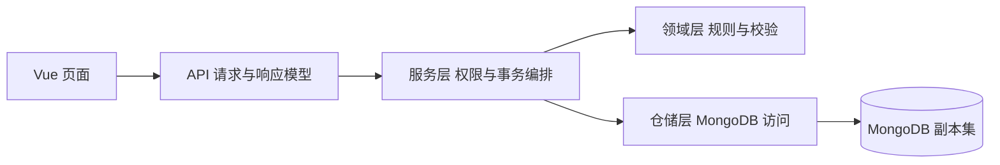

# 系统设计

设计日期：2026 年 10 月 19 日。

本大纲用于指导第一阶段的设计、实现、测试、演示和报告。目标是完整实现任务书，并以不可变发布版本、可解释规则、可靠提交、可核算统计和可复现证据体现设计质量。本文件是设计基线，不代表系统已经实现、测试通过或达到某个性能指标。

教师要求以《大作业一》为准；下文标为“项目约定”或“强化目标”的内容由本项目自行确定。实施顺序按依赖关系安排，保留高质量目标，不因单人或剩余天数自动缩减。

## 一 任务要求与成果定位

### 1.1 教师明确要求

| 编号 | 要完成的事情 | 必须交出的证据 |
|---|---|---|
| REQ-AUTH | 注册、登录、保存注册时间；用户只管理自己的问卷和统计 | 账号流程、后端归属检查、未登录与越权测试 |
| REQ-SURVEY | 标题、说明、允许匿名；列表、发布、链接、截止、关闭 | 编辑管理页面、公开填写入口、生命周期测试 |
| REQ-TYPE | 单选、多选、填空；填空支持文本与数字 | 四种内部题型模型、编辑与填写示例 |
| REQ-VALID | 单选必答；多选至少、至多、恰好；文本长度；数字上下界与整数 | 前端提示、后端最终校验、边界与拒绝用例 |
| REQ-FLOW | 根据单选、多选、数字配置跳转，默认按顺序填写 | 持久化规则、规则编辑、真实填写时的自动跳转 |
| REQ-SUBMIT | 登录填写、匿名、多用户并发、每次正式提交保存、按设置允许多填 | 正式答卷、成功回执、防重和多填测试 |
| REQ-STATS | 全卷和单题统计；单选各选项及回答数、多选选择次数、全部填空内容、数字均值 | MongoDB 聚合、文本与数字明细、人工核算样例 |
| REQ-MONGO | 全部持久化业务数据存 MongoDB；不用关系数据库和现成问卷系统框架 | 集合设计、校验器、索引脚本、真实数据库运行 |
| REQ-TEST | 至少覆盖创建、加题、跳转、校验、提交、统计，写清步骤 | 输入、操作、预期、实际结果与证据 |
| REQ-DOC | 可运行代码、配置、系统与数据库及 API 文档、关键逻辑、完成报告 | 完整提交目录、可重复启动步骤 |
| REQ-AI | 真实记录工具、提示词、产出、修改；说明 AI 帮助、错误及自己的判断 | 连续 AI 日志、报告中的分析 |
| REQ-EVOLVE | 第二阶段在第一阶段基础上修改，保留核心结构、旧数据和旧功能 | 第一阶段基线、兼容策略、决策记录、回归测试 |

“每次填写保存”按每次成功的正式提交保存解释；逐题自动保存不是任务书明文要求。数字填空既要展示逐份有效原始值，也要提供均值。

任务书评分为 MongoDB 设计 35、后端逻辑 25、测试 10、文档 15、AI 使用说明 15；两阶段权重为 30% 和 70%。因此强化成果要有数据设计、业务正确性和证据支撑，界面用于把这些成果清楚展示出来。

### 1.2 第一阶段的五项重点强化成果

| 强化成果 | 具体行为 | 验收方式 |
|---|---|---|
| 不可变发布版本 | 改草稿、发 V2，仍能按 V1 定义解释旧答卷 | 保存 V1/V2 快照、旧版本答卷及分版本统计 |
| 可解释规则 | 展示命中规则、默认去向、路径和跳过原因 | 同一组答案在创建者预览、填写和提交中结果一致 |
| 可靠提交 | 幂等重试、同人限次、编辑冲突、关闭与截止有明确语义 | 真实 MongoDB 并发测试和故障恢复证据 |
| 可核算统计 | 明确分母、未答、跳过、零值；明细与汇总相互核对 | 六份人工样例逐项一致、独立断言通过 |
| 可复现工程 | 干净环境能启动、初始化、测试和演示 | 锁定依赖、初始化脚本、执行计划和真实测试报告 |

### 1.3 需求到章节与测试的映射

| 需求 | 主要设计位置 | 计划验收 |
|---|---|---|
| REQ-AUTH | 第二、六、十节 | T01、T21 |
| REQ-SURVEY | 第二、三、六、七节 | T02、T09—T12、T18—T19 |
| REQ-TYPE、REQ-VALID | 第五节 | T02—T03、T07—T08 |
| REQ-FLOW | 第五、六节 | T04—T05、T07—T08 |
| REQ-SUBMIT | 第二、六、七节 | T12—T20 |
| REQ-STATS | 第八节 | T06、T22 |
| REQ-MONGO | 第四、七、八节 | T13、T16—T20、T23 |
| REQ-TEST | 第九节 | T01—T25 与实际结果报告 |
| REQ-DOC、REQ-AI | 第十一、十二节 | T24—T25 |
| REQ-EVOLVE | 第十三节 | 第一阶段基线核验，第二阶段再执行变更回归 |

## 二 统一业务约定

### 2.1 账号 权限与匿名

1. 填写者必须登录。后端根据当前认证用户确定创建者、填写者和权限，不接受客户端指定身份。
2. 创建者只能编辑、发布、管理和查看自己的问卷；版本、答卷、统计、导出均沿问卷验证归属。
3. 发布定义中的 `allowAnonymous=false` 时只能实名提交；为 `true` 时，填写者可明确选择匿名或实名。
4. 每份答卷保存当次匿名选择，后续设置变化不改变历史答卷的身份展示。
5. 匿名答卷只保存受保护的问卷范围参与标识，不保存实名展示对象；实名答卷另存用户 ID 与提交时用户名，供有权限的创建者查看。
6. 创建者 API 使用字段白名单；匿名答卷不返回用户 ID、用户名、内部参与标识、限次标识或摘要。统计与导出执行相同规则。
7. 匿名含义是对创建者隐藏身份；服务端拥有参与标识生成能力，不宣传为管理员也无法关联的绝对匿名。

### 2.2 草稿 发布与收集状态

| 对象或设置 | 本版约定 |
|---|---|
| 草稿 | 可编辑，成功保存使 `draftRevision` 加一 |
| 发布快照 | 发布后不可修改，完整保存题目、选项、匿名政策、约束和规则 |
| 首次发布 | 合法草稿生成 V1，问卷由 `draft` 进入 `open` |
| 后续发布 | 产生新快照，切换当前版本；不会自动重开或重置截止时间 |
| 填写版本 | `/start` 签发凭据时固定；有效 V1 凭据在发布 V2 后仍可填写 V1 |
| 旧版本入口 | 不接受浏览器任意选择历史版本；新开始默认绑定当前版本 |
| 关闭 | `open → closed`，影响全部版本的新提交；第一阶段不提供重新开启 |
| 截止 | 以服务端时间判断，恰好等于截止时拒绝新的提交；不信任客户端时间 |
| 到期状态 | `expired` 为计算状态，不自动改写 `closed`；所有者可对尚未关闭的问卷调整截止时间，不重置限次和答卷 |
| 关闭后编辑发布 | 可以继续形成草稿和版本，但问卷保持关闭，不能新收答卷 |
| 同人多填 | 问卷级设置，跨全部发布版本生效；首份正式答卷提交后永久锁定本次问卷的政策 |
| 提交后修改 | 正式答卷第一阶段只追加，不提供改答、删除或转匿名接口 |

首次发布时截止时间必须为空或在未来。截止与多填政策属于问卷实时控制状态；题目与匿名政策属于发布快照。这两个边界在 API、数据模型和测试中保持一致。

### 2.3 路径与缺失值

默认去向由编辑器初始化为显示顺序中的下一题，最后一题指向 `END`，创建者可以显式修改。运行时只按稳定 ID 与明确去向执行，不临时根据显示序号推断。

可以跳到显示序号较前的题，但全部默认边与条件边组成的完整图必须无环。第一阶段保守拒绝结构性循环，不通过“这两个条件似乎互斥”放行循环。

必答只约束本次实际到达的题目。选填未答、因跳转未到达、有效数字 `0` 是三种不同状态。路径外旧答案不参与求值、校验、保存和统计。

## 三 产品流程与工程结构

### 3.1 页面与操作流程

| 使用者 | 页面或操作 | 关键交互 |
|---|---|---|
| 所有人 | 注册、登录 | 错误清楚，登录后回到原填写入口 |
| 创建者 | 我的问卷 | 状态、截止、当前版本、创建时间、管理入口 |
| 创建者 | 草稿编辑器 | 题型配置、排序、稳定 ID、保存冲突定位 |
| 创建者 | 规则编辑与流程概览 | 条件、优先级、默认去向、结束节点，错误定位到题或规则 |
| 创建者 | 交互预览与发布检查 | 样例回答、路径解释、阻断错误和非阻断提示 |
| 创建者 | 版本历史 | 查看完整定义、版本差异、复制历史定义到新草稿 |
| 创建者 | 统计与答卷明细 | 分版本、全卷、单题、原始回答、匿名过滤、导出 |
| 填写者 | 公开链接进入 | 登录、匿名说明、当前收集状态、开始填写 |
| 填写者 | 逐题填写与回改 | 实时后端求值、必答与类型提示、上一题、跳转后的答案处理 |
| 填写者 | 提交与回执 | 提交中、成功、明确拒绝、结果待确认后的同键重试 |

页面适配电脑和手机；表单有清楚标签、键盘操作和可定位错误。执行中的流程概览与统计分母说明用于展示核心设计。

### 3.2 技术方案

采用 Vue 3、TypeScript、FastAPI、Pydantic 和官方 PyMongo Async。运行和集成测试均连接支持事务的 MongoDB 副本集；本地可用单节点副本集，不把它描述成具备高可用能力。

使用模块化单体服务。业务模块按认证、问卷与版本、规则、提交、统计划分；领域逻辑保持为不依赖 HTTP 和数据库的纯函数。



领域层不反向依赖仓储。服务层调用领域函数并组织仓储操作；避免把依赖关系写成领域层直接操作数据库的一条链。

工程初始化时锁定实际可用的数据库、Python、Node、驱动及前端依赖版本，写入锁文件和 README，不把“最新版”作为可复现环境。数据库连接跟随应用生命周期创建与关闭。参考 [MongoDB 的 FastAPI 集成](https://www.mongodb.com/docs/languages/python/pymongo-driver/current/integrations/fastapi-integration/)。

### 3.3 规模与输入边界

初始配置：每问卷最多 100 题、每选择题最多 50 项、每题最多 20 条规则、条件组合深度最多 4、每条条件树最多 100 个节点、单个文本答案最多 10000 个 Unicode 码点；定义请求最多 512 KiB，答案请求最多 1 MiB。标题、说明、规则值和列表分页均另有模型上限。

这些是项目配置值，不是教师限制；需要扩大时用边界测试和文档一起修改。计算采用线性遍历和有界条件树，不执行用户代码。请求整体超限返回 413，字段超限返回 422。

## 四 MongoDB 模型与索引

### 4.1 集合边界

| 集合 | 内容 | 选择理由 |
|---|---|---|
| `users` | 账号、密码哈希、注册时间 | 独立生命周期与唯一用户名 |
| `surveys` | 归属、草稿、修订号、收集控制状态、当前发布版本 | 编辑与收集控制需要原子修改主记录 |
| `survey_versions` | 不可变的完整发布快照 | 保留历史含义，独立查询与比较 |
| `responses` | 一次正式提交、版本、路径、有效答案、防重及隐私字段 | 独立增长、并发写入、聚合分析 |

题目、选项和规则作为有界结构嵌入草稿和快照；答卷独立保存，不在问卷主记录中无限追加答卷或答卷 ID 数组。关系数据库也能实现此系统；本作业按 MongoDB 要求，利用文档表达有界层次定义，用引用组织独立增长的答卷，并明确跨文档事务的成本。参考 [建模最佳实践](https://www.mongodb.com/docs/manual/data-modeling/best-practices/)。

用户、问卷、版本、答卷等实体 ID 使用服务端生成的 UUID 字符串，MongoDB 中也保存字符串；`publicId` 使用独立随机公开标识。题目、选项和规则 ID 使用有前缀的稳定字符串，只允许字母、数字、下划线和连字符，不含点号或美元符。日期在 MongoDB 中保存 UTC BSON Date，API 返回带时区的 ISO 8601；显示层再转换时区。计数使用非负整数，不混用字符串和数字类型。

### 4.2 最小字段契约

| 集合 | 字段 | 不变量 |
|---|---|---|
| `users` | `_id, username, usernameKey, passwordHash, createdAt, schemaVersion` | `usernameKey` 按统一规范化规则生成并唯一；第一阶段用户名不修改 |
| `surveys` | `_id, ownerId, publicId, draft, draftRevision, currentVersionId, lastVersionNo, status, deadlineAt, allowMultiple, policyLocked, settingsRevision, submitSequence, createdAt, updatedAt, schemaVersion` | 草稿、设置修订分开；提交数协调与政策锁在同一主记录 |
| `survey_versions` | `_id, surveyId, versionNo, sourceDraftRevision, definition, publishKey, publishRequestDigest, publishedAt, schemaVersion` | 同问卷版本号唯一；发布重试可恢复原结果；快照不更新 |
| `responses` | `_id, surveyId, versionId, participantKey, submissionKey, payloadDigest, canonicalizationVersion, anonymous, identity?, answers, path, acceptedSeq, acceptedAt, oneTimeParticipantKey?, schemaVersion` | 一次提交一份文档；仅存有效答案；内部字段不直接作为管理 API 响应 |

三个版本维度分开：`schemaVersion` 表示存储格式；`draftRevision` 表示编辑修订；`versionId/versionNo` 表示实际发布定义。`settingsRevision` 只用于收集设置的并发修改，不随每次答卷提交递增。

实名答卷的 `identity={userId, usernameAtSubmit}`；匿名答卷完全省略该字段。`participantKey` 由服务端以稳定密钥对问卷 ID 与当前用户 ID 作带密钥摘要产生，创建者不可见。密钥由安全配置提供，重启保持不变；第一阶段不在有历史答卷时直接更换参与标识密钥。

`answers` 在 API 中使用对象，在 MongoDB 中转成数组，便于聚合：

```json
{
  "answers": [
    {"questionId": "q_age", "kind": "number", "value": 17},
    {"questionId": "q_hobby", "kind": "multi", "value": ["read", "sport"]}
  ],
  "path": ["q_age", "q_minor", "q_hobby", "q_score", "q_note"],
  "acceptedSeq": 1
}
```

数组按实际路径顺序生成，问题 ID 不重复；多选值按固定顺序规范化。到达但未答的选填题存在于 `path`，不存在于 `answers`；跳过题两者均不存在。`acceptedSeq` 是同问卷成功提交的递增序号，用于稳定统计范围，不等同于某版本答卷数。

### 4.3 数据校验职责

1. API 严格模型：检查请求结构、类型、枚举、未知字段、长度、ID 与数字合法性。
2. 领域层：根据对应定义检查题目、选项、规则、动态约束与实际路径。
3. MongoDB 校验器：检查稳定 BSON 结构、必填字段、日期、计数、答案元素类型，以及匿名与实名字段的本地一致性。
4. 服务层事务：保证引用归属、实时政策、发布与提交之间的跨文档不变量。集合校验器不会自动读取另一个集合的政策。

初始化脚本真正创建校验器和索引，附样例 BSON、合法和非法插入示例。发布不可变性由仓储写入边界、权限和测试保障；不能声称仅靠 `schemaVersion` 或普通 JSON Schema 自动保证不可修改。

### 4.4 索引清单

| 集合 | 索引 | 用途 |
|---|---|---|
| users | `{usernameKey:1}` 唯一 | 防并发重复注册 |
| surveys | `{publicId:1}` 唯一 | 公开入口解析 |
| surveys | `{ownerId:1, createdAt:-1, _id:-1}` | 本人列表与稳定分页 |
| survey_versions | `{surveyId:1, versionNo:1}` 唯一 | 版本号与历史查询 |
| survey_versions | `{surveyId:1, publishKey:1}` 唯一 | 发布幂等 |
| responses | `{surveyId:1, participantKey:1, submissionKey:1}` 唯一 | 提交幂等 |
| responses | `{surveyId:1, oneTimeParticipantKey:1}` 部分唯一 | 禁止多填时的问卷范围限次 |
| responses | `{surveyId:1, acceptedSeq:1}` 唯一 | 提交序号不重复 |
| responses | `{surveyId:1, versionId:1, acceptedSeq:-1}` | 分版本汇总、明细与固定范围导出 |

部分唯一索引过滤条件固定为 `{"oneTimeParticipantKey":{"$type":"string"}}`。禁止多填时后端令其等于 `participantKey`；允许多填时完全省略，不写 `null`。索引只约束符合过滤条件的文档，必须与事务内政策读取、字段生成和集成测试配合。参考 [唯一索引](https://www.mongodb.com/docs/v8.0/core/index-unique/) 与 [部分索引](https://www.mongodb.com/docs/manual/core/index-partial/)。

索引名称固定，错误分类有明确映射，但业务恢复不依赖“先撞哪一个唯一索引”。新增索引必须说明访问场景、扫描收益和额外写入成本。

## 五 题型与规则的统一协议

### 5.1 问卷定义与题型

发布定义包含 `title, description, allowAnonymous, entryQuestionId, questions[]`。题目统一为 `{id, kind, title, required, config, defaultTarget, rules[]}`；数组顺序仅表示编辑与展示顺序。`END` 为保留终点，不允许作为题目 ID。

| 内部 kind | 任务书题型 | config 与约束 |
|---|---|---|
| `single` | 单选 | `options:[{id,label}]`，答案必须是本题一个选项 ID |
| `multi` | 多选 | options、`minSelected/maxSelected`；恰好 N 用 min=max=N 表达 |
| `text` | 文本填空 | `minLength/maxLength`，按规范化后 Unicode 码点计数 |
| `number` | 数字填空 | `min/max/integerOnly`，数字上下界包含边界 |

可空边界用 `null` 表示未设置；若同时存在上下界必须前者不大于后者。多选数限制必须与选项数相容。所有题型统一支持 `required`；选填且缺失时不检查最小长度、最小选择数或数字范围，非缺失时全部检查。

数字输入只接受有限 JSON 数字，拒绝数字字符串、布尔值、NaN 和 Infinity；整数判断按数学值，`18.0` 可通过，`18.5` 不可通过。数值绝对值不超过 9007199254740991，避免超出前后端安全整数范围；整数存 BSON Int64，非整数存 double，非整数计算按浮点数处理。手机号示例可以通过整数题演示，不能漏掉任务要求的数字与整数校验。

### 5.2 答案与缺失值

```json
{
  "q_age": 17,
  "q_hobby": ["read", "sport"],
  "q_note": null
}
```

| kind | 非缺失答案 | 缺失表示 |
|---|---|---|
| single | 合法选项 ID 字符串 | 未提供、`null` |
| multi | 合法选项 ID 数组；重复选项报错，不能静默去重 | 未提供、`null`、空数组 |
| text | 字符串，服务端去首尾空白后校验与保存 | 未提供、`null`、规范化后空串 |
| number | 有限 JSON 数字，`0` 是有效答案 | 未提供、`null` |

数字题的 `[]`、单选题的空字符串等属于非法值，不能一概转成缺失。规范化以同一后端实现为准；前端发送控件未填值时统一使用 `null`。多选采用集合语义，规范化排序使不同排列得到相同摘要。数字规范化使 `1` 与 `1.0`、`0` 与 `-0` 分别得到相同语义。

未知题目 ID 返回错误；已知但不在本次路径上的旧值被忽略，不影响校验。保存答案必须由领域引擎生成，不能直接持久化客户端对象。

### 5.3 条件语法与执行顺序

条件只引用规则所属当前题，不提供跨题 `questionId` 字段。这样隐藏题缓存不会参与后续条件；如第二阶段需要跨题逻辑，再引入明确的已到达有效答案上下文。

```json
{
  "id": "q_age",
  "kind": "number",
  "title": "年龄",
  "required": true,
  "config": {"min": 0, "max": 120, "integerOnly": true},
  "defaultTarget": "q_adult",
  "rules": [
    {
      "id": "r_minor",
      "priority": 10,
      "condition": {"operator": "lt", "value": 18},
      "target": "q_minor"
    }
  ]
}
```

| 类别 | 允许运算符或语法 | 精确定义 |
|---|---|---|
| 单选 | `eqOption` | 等于某个合法选项 ID |
| 多选 | `containsAny, containsAll, setEquals` | 集合交集非空、包含全部、集合相等；比较集合必须非空且无重复 |
| 数字 | `lt, lte, gt, gte, eq` | 对合法数值比较 |
| 数字区间 | `between` | `value={min,max}`，闭区间且 min≤max |
| 组合 | `{"allOf":[条件,...]}`、`{"anyOf":[条件,...]}` | 至少一个子条件，所有叶子都针对当前题，受深度与节点数限制 |

每个条件对象只能采用一种语法，拒绝未知字段和不适用的运算符。文本题第一阶段只配置默认去向。缺失答案的普通叶子条件全部为假，不将数字缺失转成零。

同题规则的 `priority` 为不重复整数，数值越小越先执行，第一条命中后停止；均不命中使用默认去向。重叠规则可产生提示，优先级使结果确定，不把所有重叠都当作错误。

### 5.4 发布检查

阻断：空问卷、缺失入口、重复题目/选项/规则 ID、非法目标、选项不属于当前题、条件与题型不匹配、矛盾约束、缺少默认去向、结构性循环、超出规模上限。

从全部默认边和条件边构图，对完整图判环，并检查入口可达部分最终能到达 `END`。默认顺序造成的回路同样拒绝；只检查显式跳转边是不够的。

提示：不可达题、明显重复或重叠规则、可识别的遮蔽规则。提示不会声称已经证明任意组合条件没有逻辑冲突。错误对象带 `questionId/ruleId/field`，能定位到编辑器。

### 5.5 唯一求值入口

统一函数：`evaluate(definition, rawAnswers, mode)`，返回 `path, activeAnswers, trace, errors, blockedAt, complete, provisional`。发布检查另用 `validate_definition`；类型规范化与条件求值作为内部纯函数，预览、填写、提交不复制三套引擎。

| 模式 | 遇到必答缺失或非法值 | 用途 |
|---|---|---|
| interactive | 在当前题暂停，`blockedAt` 指向该题，后续去向尚未确定 | 填写与逐步调试 |
| final | 记录错误，可沿默认边继续收集错误；路径标为 `provisional=true`，整份拒绝保存 | 完整预览检查、正式提交 |

遍历从入口开始，每次只规范化、校验当前到达题。合法非缺失值加入有效答案并参与条件；选填缺失采用默认边；到达 `END` 才结束。运行时另有步数上限和异常保护。

成功的 final 结果必须无错误、到达终点且非暂定；提交接口强制 final，不接受客户端降低校验模式。回改后从入口重算，路径外旧值立即退出有效集；可以在页面内存缓存中保留供恢复，恢复后重新校验。

成功结果应满足：用 `activeAnswers` 再求值，路径和有效答案保持一致。参考 [ODK 表单逻辑](https://docs.getodk.org/form-logic/) 和 [隐藏答案与级联条件](https://surveyjs.io/form-library/examples/conditional-logic-and-branching-in-surveys/documentation)，只借鉴行为，自行实现引擎。

## 六 接口与跨模块契约

### 6.1 接口清单

全部业务 API 采用 `/api` 前缀；网页分享地址为 `/survey/{publicId}`。

| 接口 | 身份 | 核心输入或输出 |
|---|---|---|
| `POST /auth/register`、`POST /auth/login` | 注册或登录 | 用户名密码；不返回密码哈希 |
| `GET /auth/me` | 登录 | 当前账号与注册时间 |
| `POST /surveys`、`GET /surveys`、`GET /surveys/{id}` | 创建者 | 新建、本人分页列表、编辑详情 |
| `PUT /surveys/{id}/draft` | 创建者 | 完整 definition、expectedDraftRevision；返回新修订号 |
| `POST /surveys/{id}/preview` | 创建者 | 待预览 definition、answers、mode；执行同一引擎，可预览未保存内容 |
| `POST /surveys/{id}/publish` | 创建者 | expectedDraftRevision、expectedCurrentVersionId、publishKey |
| `PATCH /surveys/{id}/settings` | 创建者 | expectedSettingsRevision、deadlineAt 和/或 allowMultiple |
| `POST /surveys/{id}/close` | 创建者 | expectedSettingsRevision；已关闭可返回当前状态 |
| `GET /surveys/{id}/versions`、`GET /surveys/{id}/versions/{versionId}` | 创建者 | 历史列表、完整定义；版本必须属于该问卷 |
| `GET /survey/{publicId}` | 登录 | 当前状态与公开版本信息，不返回内部防重字段 |
| `POST /survey/{publicId}/start` | 登录 | 服务端选定当前版本，返回 fillToken、versionId、expiresAt、公开定义 |
| `POST /survey/{publicId}/evaluate` | 登录且有效填写凭据 | versionId、answers；强制 interactive，返回路径、错误和解释 |
| `POST /survey/{publicId}/submit` | 登录 | 幂等键、versionId、anonymous、answers；新提交才要求有效填写凭据 |
| `GET /surveys/{id}/stats` | 创建者 | versionId 必填，可按 questionId；返回统计范围与口径 |
| `GET /surveys/{id}/responses` | 创建者 | versionId、游标、asOfSeq、可选 questionId；实名或匿名明细 |
| `GET /surveys/{id}/export` | 创建者 | 固定版本与统计范围；相同隐私过滤 |

版本差异由两个完整快照按稳定 ID 比较；复制历史版本通过正常保存草稿接口，仍需预期草稿修订号，不绕过并发控制。

### 6.2 填写与提交请求

填写凭据使用独立用途的服务端签名令牌，绑定当前用户、surveyId、versionId、签发和过期时间。它与登录令牌分开验证；不能把客户端声称的版本或开始时间当成授权。

提交头使用 `Idempotency-Key` 与可选的 `X-Fill-Token`，请求体如下。`X-Fill-Token` 在结构层允许缺失或过期，是否必须有效在幂等查询后决定，避免中间件提前阻断已成功重放。

```json
{
  "versionId": "7d2fd79e-3ff1-4b5d-b48b-4f2bbad83f37",
  "anonymous": true,
  "answers": {"q_age": 17, "q_hobby": ["read", "sport"]}
}
```

成功回执由不可变保存字段生成，包含 receiptId、versionId、acceptedAt、anonymous、status；首次成功返回 201，同内容重放返回 200，回执主体相同。客户端在结果明确前保持同一幂等键；改变答案或匿名选择后，应创建新的正式提交尝试，仍受多填政策约束。

填写求值响应至少包含下面的结构。客户端对改答请求标记顺序，较早返回的旧响应不能覆盖新的填写状态。

```json
{
  "path": ["q_age"],
  "activeAnswers": {},
  "trace": [],
  "errors": [{"questionId": "q_age", "code": "REQUIRED", "message": "请填写年龄"}],
  "blockedAt": "q_age",
  "complete": false,
  "provisional": false
}
```

### 6.3 错误格式

统一错误体为 `{code,message,fieldErrors,requestId}`；题目错误附 questionId，规则错误附 ruleId。401 表示当前账号未登录或登录过期；不属于当前创建者的管理资源统一 404；422 为结构或答案校验错误；409 为编辑、发布、幂等、限次、关闭、截止或政策锁冲突，并用稳定业务 code 区分。

基础 code 包括 `DRAFT_CONFLICT`、`PUBLISH_CONFLICT`、`IDEMPOTENCY_CONFLICT`、`ALREADY_SUBMITTED`、`SURVEY_CLOSED`、`SURVEY_EXPIRED`、`POLICY_LOCKED`、`FILL_CREDENTIAL_EXPIRED`。数据库暂时不可用或提交结果尚未确认返回可重试的 503 code，不把未知结果写成“确定没有保存”。

## 七 并发 编辑与可靠提交

### 7.1 草稿保存与发布

草稿保存采用 `{_id,ownerId,draftRevision:expected}` 条件更新，成功后递增修订号。未命中不能退化成无条件覆盖。

发布先按 surveyId、publishKey 查已成功版本：相同发布请求返回原结果，不重复发版，也不把当前指针回退到历史版本；不同请求内容复用同键返回 409。摘要覆盖预期草稿修订号与预期当前版本。

对新发布，在同一事务中读取并核对归属、`expectedDraftRevision`、`expectedCurrentVersionId`，校验对应草稿，生成新快照与递增版本号，并有条件切换主记录。任一步失败全部回滚。事务冲突重试后仍必须重新核对预期值，不能自动把未审阅的新草稿发布出去。

`expectedCurrentVersionId` 首次发布为 `null`，仍是必须提供的预期值。发布失败或返回不明时，先恢复同 publishKey 的成功结果，再决定返回冲突或待确认。

### 7.2 幂等内容的定义

幂等作用域为 `surveyId + participantKey + submissionKey`。摘要采用有版本的规范化过程，至少包括：

```text
canonicalizationVersion
versionId
anonymous
由对应版本引擎生成的规范化有效答案
```

对象键排序、多选排序、数值等价和文本规范化均固定；按固定格式将规范化对象编码成 UTF-8 JSON，再计算 SHA-256。匿名选择属于持久化语义，必须进入摘要。路径由版本与答案导出，不信任客户端路径；路径外缓存不改变一次提交的语义。

查到旧成功记录后，用该记录绑定的版本及规范化版本解释请求，核对匿名状态与摘要；一致返回原回执，语义改变返回 409。第一阶段不删除该发布定义、不改历史规范化含义。

### 7.3 新提交与成功重放的顺序

1. 验证当前登录账号，检查请求基本结构和大小，服务端派生参与标识。
2. 按幂等作用域查既有成功记录；存在则核对版本、匿名与规范化摘要并返回原回执。这里不要求填写凭据未过期，不要求问卷仍开放。
3. 仅对未成功的新请求，验证有效填写凭据及绑定关系，读取对应不可变版本，校验匿名选择，强制 final 求值，生成有效答案。
4. 进入提交事务，协调实时收集状态与政策，保存一份答卷，见下一节。
5. 事务确认提交成功后才返回正式成功回执。

重要竞态：第 2 步未查到后，另一个同键请求仍可能成功。后续遇到唯一冲突、限次、关闭、截止或提交结果不明时，完成驱动规定的事务或提交重试、离开事务上下文后，再按同作用域重查已提交结果；若内容一致，优先恢复成功回执。不能只在某一种重复键错误下恢复，也不能把未知提交结果直接当作已回滚。

当前登录已经过期仍需重新登录，登录同一账号后可继续恢复；不因为允许过期填写凭据重放而跳过账号认证。

### 7.4 提交 关闭 截止与多填政策的原子边界

在每次事务尝试中执行下列顺序，全部数据库操作使用同一 session：

1. 对 surveys 主记录执行 `find_one_and_update`，条件包括该问卷仍为 `open`，真实递增 `submitSequence`，并设置 `policyLocked=true`，返回更新后的记录。此操作必须是真写，不能替换为普通读取或无变化更新。
2. 真写成功返回后，立即重新读取服务端 UTC 时间，作为本次 `acceptedAt`。以返回记录中的 deadlineAt 判断：为空或 acceptedAt 严格小于截止才可继续，否则中止整个事务。这样不会沿用等待数据库写入前的旧时间。
3. 使用这次返回的 `allowMultiple` 决定是否生成 `oneTimeParticipantKey`，不得使用事务外预读政策；同时取得本次 `acceptedSeq`。
4. 插入经过校验的正式答卷，包含版本、匿名状态、有效答案、路径、摘要、序号和时间；提交事务。失败时答卷、序号递增和政策锁一起回滚。

关闭操作真实修改同一主记录的 status；截止设置修改同一主记录的 deadlineAt；政策修改使用 `policyLocked=false + expectedSettingsRevision` 条件，并递增 settingsRevision。它们与提交争用同一文档，从而形成明确顺序。

若政策修改先成功，重试后的提交必须使用新政策；若首份提交先成功，政策修改必须收到 `POLICY_LOCKED`。所有正式答卷使用锁定政策生成限次字段，不会留下漏入部分唯一索引的首份答卷。

接受判定点是持有上述事务写入协调后进行的服务端时间检查，且该事务最终成功提交。通过接受检查的在途请求允许在截止后返回响应；截止后才通过检查的新请求拒绝。关闭先完成时新提交失败；提交先取得协调并通过检查时，关闭等待其提交或回滚。服务端时间以部署机器 UTC 为准，记录该项目约定，不声称跨多台未校时服务器拥有绝对一致的物理时钟。

### 7.5 事务 重试与代价

使用主节点读取、事务 snapshot 读取语义和 majority 提交确认，启动时检查副本集与事务可用性。事务只包含必要数据库操作，不在事务内进行 HTTP 调用、发送通知或重复计算完整问卷。

驱动可能重跑事务回调，回调中所有实时状态与时间必须重新取得。事务回调重跑与提交确认重试分开处理；出现提交结果不明，先按驱动支持的机制重试提交，不自行无条件再写一份答卷。重试有明确的时间预算，超过预算时恢复同键结果；仍无法确认则提示“结果待确认，请以同一标识重试”。同一事务内的数据库操作顺序执行，不并行使用同一 session。参考 [PyMongo 事务](https://www.mongodb.com/docs/languages/python/pymongo-driver/current/crud/transactions/)。

每份问卷的主记录会成为提交协调热点。这是严格关闭与政策锁语义的成本，性能实验必须实测同问卷并发与多问卷并发，不将该设计宣传为无限水平扩展。参考 [原子性与事务](https://www.mongodb.com/docs/manual/core/write-operations-atomicity/) 和 [事务部署及并发限制](https://www.mongodb.com/docs/manual/core/transactions-production-consideration/)。

## 八 统计 明细与可核算样例

### 8.1 固定统计范围

默认要求明确指定 versionId；UI 可以默认选择当前版本，但必须显示版本号。历史答卷始终按对应快照解释，不因题目 ID 相同就跨版本合并。

一次统计在同一只读 snapshot 事务内读取主记录的 `submitSequence=N`，并按 surveyId、versionId、`acceptedSeq≤N` 计算完整汇总，响应带 `asOfSeq=N`。后续明细和导出使用相同范围；新提交不会插入到这次范围中。

该做法依赖第一阶段答卷只追加、不修改删除，以及提交主记录序号和答卷在同一事务内保存。明细采用主节点 majority 读取；游标包含固定范围与上次 acceptedSeq。asOfSeq 不能超过当前已提交序号，默认新查询创建新的范围。第二阶段若引入删改答卷，需要重新设计快照与审计语义。

### 8.2 统计单位与公式

汇总同时标明答卷数和独立参与人数。独立人数仅在后端按内部 participantKey 去重，输出计数，不输出标识。允许多填时不能把六份答卷写成六个人。

对固定版本、固定统计范围和题目定义：

| 符号 | 含义 | 计算来源 |
|---|---|---|
| R | 正式答卷数 | 范围内 responses 文档数 |
| V | 到达题目的答卷数 | path 包含 questionId 的答卷数 |
| A | 有效回答题目的答卷数 | answers 中包含该题有效元素的答卷数 |
| U | 到达但未答 | 到达集合与有效回答集合的差集大小 |
| S | 未到达 | 总答卷集合与到达集合的差集大小 |

独立验证 `0≤A≤V≤R`、`U≥0`、`S≥0`、`R=A+U+S`。U、S 的期望集合由原始路径和答案独立核对，不能只用减法定义后检查同一个恒等式。

| 题型 | 必须展示 | 口径与边界 |
|---|---|---|
| 单选 | 各选项答卷计数、选择该项的独立人数、有效回答答卷数和人数 | 答卷口径各选项之和=A；独立人数另算，跨次改选时各项人数之和不必等于总人数 |
| 多选 | 各选项选择次数、有效回答数、可选独立人数 | 每份合法答卷每选项至多一次；次数占比按 A 为分母，可合计超过 100% |
| 文本 | 全部有效文本分页明细、到达未答与跳过数 | 不合并相同文本，不遗漏匿名文本 |
| 数字 | 全部有效数字分页明细、回答数、总和、均值 | 0 计入；未答与跳过不计入；无人回答 avg=null，显示暂无数据 |

均值按答卷计，不先按人去重；保留计算原值，显示时可四舍五入到两位。浮点样例核对使用明确容差，整数计数必须精确一致。

### 8.3 聚合实现与执行计划

先 `$match` 问卷、版本和序号范围，再按任务分别计算答卷总量、路径到达量、答案分布、数值和独立人数。可用 `$facet` 组织有界汇总；明细必须分页，不把全部长文本塞进一个聚合输出数组。

多选的二次 `$unwind` 只用于该多选的选项次数。数字平均值从数值回答独立聚合，不能在多选展开后的行上计算，避免重复加权或空数组导致丢行。零选择选项依据不可变定义补零。

记录关键查询的实际执行计划、`nReturned`、`totalDocsExamined`、`totalKeysExamined` 和访问路径；对照索引前后扫描量，结合重复测量分析时间，不用单次毫秒值证明性能。参考 [MongoDB 执行计划](https://www.mongodb.com/docs/manual/tutorial/analyze-query-plan/)。

### 8.4 六份人工可核算答卷

这组样例是必须实现的种子数据和自动核对基础，当前仅为设计期的人工期望值。统一属于一个 V1 问卷，允许同人多填，六次使用不同提交键。

| 题目 | 类型与约束 | 去向 |
|---|---|---|
| q_age | 必答数字，整数 0—120 | 小于 18 → q_minor；默认 q_adult |
| q_minor | 选填文本，非空时 1—100 码点 | 默认 q_hobby |
| q_adult | 必答单选，student/worker | 默认 q_hobby |
| q_hobby | 必答多选，read/sport/music，选 1—2 项 | 默认 q_score |
| q_score | 选填数字，0—10 | 默认 q_note |
| q_note | 选填文本，非空时 1—100 码点 | 默认 END |

入口为 q_age。未成年路径为 `q_age → q_minor → q_hobby → q_score → q_note → END`；成年路径以 q_adult 替换 q_minor。两条分支均无环。

| 答卷 | 内部样例参与者 | 匿名 | age | minor | adult | hobby | score | note |
|---|---|---|---:|---|---|---|---:|---|
| R1 | U1 | 是 | 17 | 学生 | 跳过 | read,sport | 0 | 未答 |
| R2 | U2 | 否 | 18 | 跳过 | student | read | 8 | 课程很好 |
| R3 | U3 | 是 | 20 | 跳过 | worker | sport,music | 6 | 未答 |
| R4 | U4 | 否 | 16 | 未答 | 跳过 | music | 未答 | 希望增加活动 |
| R5 | U1 | 是 | 18 | 跳过 | student | read,music | 10 | 未答 |
| R6 | U5 | 否 | 12 | 参加兴趣班 | 跳过 | sport | 4 | 未答 |

U1 等标识仅为受控测试数据中的核算标签，不作为匿名管理响应字段。

| 题目 | R | V | A | U | S | 人工预期 |
|---|---:|---:|---:|---:|---:|---|
| q_age | 6 | 6 | 6 | 0 | 0 | 总和 101，均值 101/6，显示 16.83 |
| q_minor | 6 | 3 | 2 | 1 | 3 | 两条文本：学生、参加兴趣班 |
| q_adult | 6 | 3 | 3 | 0 | 3 | student=2，worker=1，回答人数=3 |
| q_hobby | 6 | 6 | 6 | 0 | 0 | read=3，sport=3，music=3，总次数=9 |
| q_score | 6 | 6 | 5 | 1 | 0 | 总和 28，均值 5.6；数值 0 计入五份回答 |
| q_note | 6 | 6 | 2 | 4 | 0 | 两条文本均可在明细中查到 |

另外预期：6 份答卷、5 名独立参与者、3 份匿名、3 份实名。多选每项的答卷占比均为 3/6=50%；read 的独立人数为 2，sport 和 music 均为 3，不能把这两组计数混为同一口径。

另加拒绝样例 `age=true`、`age="18"`、`age=18.5`、`hobby=[read,read]`、`score=11`；它们不得使正式答卷数从 6 增加。空答卷统计和“全部题均选填”的合法空答案提交使用独立测试问卷，不混入本组必答年龄的六份样例。

## 九 测试矩阵与证据标准

### 9.1 测试分层

| 层次 | 目的 | 使用方式 |
|---|---|---|
| 领域单元测试 | 题型规范化、条件、图检查、路径与统计口径 | 不连接数据库，覆盖边界与性质 |
| 真实 MongoDB 集成测试 | 校验器、唯一索引、事务、政策锁与并发 | 独立测试库，使用副本集，验证最终文档 |
| API 测试 | 认证、归属、请求响应、业务错误与重试 | 启动应用生命周期和真实数据库连接 |
| 页面端到端测试 | 创建到统计、实时跳转、错误定位与回改 | 浏览器操作，核对接口与实际保存 |
| 故障与性能实验 | 中途失败、未知结果恢复、真实吞吐与扫描代价 | 可控故障注入，保留原始数据 |

异步 API 测试正确处理 lifespan 和事件循环，不只 mock 掉数据库后检查 HTTP 状态。参考 [FastAPI 异步测试](https://fastapi.tiangolo.com/advanced/async-tests/)。前端检查包含 TypeScript 类型检查、构建和核心流程，不能用构建成功代替类型检查，参考 [Vue TypeScript](https://vuejs.org/guide/typescript/overview.html)。

### 9.2 必测用例

| 编号 | 需求或强化目标 | 关键输入与操作 | 确定的预期结果 |
|---|---|---|---|
| T01 | 账号与权限 | 注册登录；并发注册同用户名；未登录访问 | 只建立一个唯一账号，未认证拒绝 |
| T02 | 问卷与加题 | 创建问卷，加入四种 kind，保存重开 | 字段、约束、顺序与 ID 正确持久化 |
| T03 | 题型校验 | 上下界、精确多选数、Unicode 文本、0、布尔与数字字符串 | 边界合法；类型、数量和范围错误被定位 |
| T04 | 跳转 | 单选、多选、数字 17/18、组合条件与重叠规则 | 配置化求值，优先级和默认去向可解释 |
| T05 | 图检查 | 默认边造成回路、失效目标、合法向前显示序号跳转 | 回路和无效引用拒绝，完整 DAG 接受 |
| T06 | 统计 | 第八节六份样例、文本及数字明细、零次选项 | 各项与人工预期一致，人数和答卷分开 |
| T07 | 回改 | 分支题曾填写非法或合法旧值，改入口答案 | 旧分支不影响新路径、校验、保存或统计 |
| T08 | 预览一致性 | 同定义和答案分别预览、实时求值、正式提交 | 成功路径与有效答案一致；待答不提前确定后续 |
| T09 | 编辑冲突 | 两个页面基于同修订保存 | 后者 409，不覆盖先前保存 |
| T10 | 发布冲突 | 预览 r5 后另一页存 r6，再用 r5 发布 | 409，不发布未确认草稿 |
| T11 | 发布幂等与回滚 | 同 publishKey 重试；插入快照后注入异常 | 同键只一版；失败无孤立指针；响应丢失可恢复 |
| T12 | 历史版本 | 发 V1、开始填写，再发 V2，用有效凭据交 V1 | 答卷绑定 V1；V2 本身不改变 V1 数据解释 |
| T13 | 提交幂等 | 同键同内容并发 20 次 | 一份答卷，同一回执，序号只消耗一次 |
| T14 | 幂等冲突 | 同键改变答案、版本或 anonymous | 返回 409，原记录不变 |
| T15 | 成功重放 | 首次成功但回执丢失，随后过期、关闭或服务重启 | 重新登录后同键同内容仍返回原回执 |
| T16 | 多填限次 | 同人 20 个不同键并发；再跨版本尝试 | 禁多填只一份；允许多填可有多份，人数仍去重 |
| T17 | 政策竞态 | 首次提交与 allowMultiple 修改用屏障控制先后 | 设置先则用新政策；提交先则政策锁定，无漏限次记录 |
| T18 | 关闭竞态 | 提交先取得协调/关闭先完成，两种受控顺序 | 各符合第七节语义，无“先查后插”竞态 |
| T19 | 截止 | 截止前、恰好截止、截止后；写入等待跨过截止 | 仅接受判定时间严格早于截止的尝试可成功 |
| T20 | 重试与不明结果 | 冲突重试、提交确认丢失、相同键已成功后再关闭 | 每次尝试重验实时状态；可恢复成功或明确待确认 |
| T21 | 归属与匿名 | 替换 survey/version/response ID；查明细与导出 | 越权拒绝；匿名没有身份与内部标识；实名姓名来源明确 |
| T22 | 统计固定范围 | 取得 asOfSeq 后持续加入新答卷，再分页导出 | 同范围数量与内容保持一致；刷新范围才增加 |
| T23 | MongoDB 约束 | 非法 BSON、缺失必要字段、重复键、事务中途失败 | 校验器与索引有效，失败不留下半份结果 |
| T24 | 可复现交付 | 新数据库与新环境按 README 初始化运行 | 能启动、导入样例、跑测试并完成演示 |
| T25 | 文档与 AI 使用 | 人工抽查需求映射、原始 Prompt、产出文件、修改和验证记录 | 必交文档齐全；事实可追溯；计划与实际结果明确分开 |

T01—T25 是计划，不预填“通过”。每条完整测试记录包含前置环境、具体请求或操作、数据库前后状态、预期、实际结果、执行时间、关联提交和证据路径。T25 为人工材料核验，不冒充自动测试。

### 9.3 性质与故障验证

对合法定义和成功答案检查：路径有限且到达 END、题目不重复、有效答案属于路径、规范化再次执行保持一致、移除路径外答案不改变成功路径、改题目展示文字不破坏稳定引用。

并发测试使用可控屏障或事务内故障点确定先后，记录每个请求的结果与最终数据库文档；不只依赖多跑几次或随机睡眠。未知提交结果测试使用可控连接中断或测试代理，保留实际故障方式，不把普通回调异常冒充提交确认丢失。

### 9.4 性能实验

固定种子生成至少一组约一万份答卷的实验数据，另保留小样例用于正确性。并发级别可取 1、5、20、50，分别测试同一问卷提交、多个问卷提交、列表、分版本统计与明细。

记录硬件、操作系统、运行版本、副本集拓扑、数据规模、预热、请求分布、重复次数、吞吐、P50/P95、错误类型、最终入库量和执行计划。合法唯一键冲突与基础设施失败分开统计；压测结束校验实际入库数。

性能目标先以稳定、可解释和数据正确为准，结果由实测填写。若需要调优，保留调优前后同样条件的结果与取舍；测试数据量调整要说明原因。

## 十 安全与运行配置

密码使用成熟库提供的单向密码哈希，采用 Argon2id；不自行实现密码学。登录令牌验证签名、用途与有效期，填写令牌绑定账号和发布版本。密码哈希、令牌、参与标识密钥和连接串不得出现在接口、导出或提交仓库中。

用户名先做 Unicode NFKC 规范化并去首尾空白，规范化后长度为 3—32 个码点，只允许 Unicode 字母、数字和下划线；该值作为展示用户名，casefold 后得到 usernameKey。注册和登录使用同一规则，测试规范化碰撞。密码长度为 8—128 个码点，不自动去空白或更改字符。所有归属检查在后端执行，前端隐藏按钮不作为权限控制。

普通文本按文本渲染，不直接作为 HTML；导出 CSV 除正常转义外，还要处理可能被表格软件当成公式的单元格，数据库原始回答不因此改写。列表与导出限制分页和规模，不能让一次请求读取无限数据。

`.env.example` 仅放占位项和配置说明。真实业务数据只存 MongoDB；当前填写的临时内存状态不作为可靠存储。若实现跨设备自动保存，新增 MongoDB 草稿集合，并另行明确版本绑定、匿名、过期与正式提交的关系。

README 提供至少一种经过实际验证的本地启动路径，说明 MongoDB 副本集初始化、健康检查、连接、建库校验器与索引、种子数据、前后端启动及停止。持久化数据库目录和密钥在重启后保持，不在每次启动时重置业务数据。

## 十一 开发顺序与完成门槛

| 关卡 | 工作 | 进入下一步所需证据 |
|---|---|---|
| M0 环境与并发原型 | 锁定环境、连接副本集，验证真实事务和共享状态协调 | 可以重复执行提交/关闭/政策竞态的最小实验 |
| M1 数据与领域契约 | 四集合模型、校验器、索引、题型规范化、规则协议 | 合法非法模型样例、规则单测与完整 DAG 检查 |
| M2 最小完整链路 | 账号、创建、四 kind、发布、填写、提交、统计 | 一条真实端到端链路，数据库可查到完整结果 |
| M3 规则与版本体验 | 创建者预览、填写实时求值、回改、版本历史与差异 | 同一引擎一致性、V1/V2 并存和旧凭据测试 |
| M4 可靠性与权限 | 发布 CAS、幂等、政策锁、关闭截止、匿名和导出 | T09—T21 的真实数据库与 API 证据 |
| M5 核算与性能 | 六份样例、固定统计范围、查询计划、性能实验 | 人工数值逐项一致、原始实验材料可复现 |
| M6 完整交付 | 页面打磨、干净环境、需求映射、报告与 AI 日志 | T24、T25 和连续演示完成，无虚构结果 |

需求、测试、决策和 AI 日志从 M0 开始维护。页面显示、代码生成、构建成功分别只是局部证据，不能替代保存正确、权限正确或并发正确。

跨设备自动保存、更多模板、复杂拖拽画布等作为独立体验增强项。每项新增都遵循已有版本、隐私、规则和统计契约，单独验收；核心强化成果维持第一阶段目标。

## 十二 交付目录 报告与演示

### 12.1 提交目录

```text
backend/                     路由 服务 领域模型 MongoDB 仓储
frontend/                    编辑者与填写者页面
scripts/                     初始化 种子数据 演示 性能实验
tests/                       单元 数据库集成 API 页面 并发
docs/requirements.md         需求到字段 接口 测试和证据的映射
docs/schema.md               BSON 样例 校验器 索引 建模取舍
docs/protocol.md             题型 条件 答案 规范化 缺失值
docs/api.md                  请求响应 错误码 权限与幂等契约
docs/decisions.md            架构和业务约定 兼容性与变更理由
docs/test-report.md          环境 步骤 实际结果 失败与证据
docs/performance.md          数据生成 执行计划 压测与代价
docs/ai-log.md               真实 Prompt 产出 修改与验证
docs/phase1-report.md        第一阶段完整项目完成报告
docs/demo.md                 按步骤可重复的演示脚本
README.md                    环境 初始化 启动 测试 演示
.env.example                 配置占位与解释
锁文件或依赖清单              固定实际验证过的依赖版本
```

### 12.2 完成报告大纲

1. 项目目标、原始需求和第一阶段实现范围。
2. 总体结构、页面流程、模块边界和关键业务约定。
3. MongoDB 设计：访问负载、候选结构、嵌入与引用、冗余、校验器和索引取舍。
4. 题型与校验：类型、缺失、零值、边界与错误反馈。
5. 跳转设计：规则协议、默认边、完整图检查、统一引擎与回改。
6. 版本与并发：发布快照、CAS、幂等、限次、政策锁、关闭和截止。
7. 统计：数据范围、答卷与人数、原始明细、聚合和六份人工核算。
8. 测试和性能：方法、真实结果、失败、执行计划、运行环境和局限。
9. AI 使用：工具和原始提示词、有效帮助、错误、人工判断与修改。
10. 遇到的问题和解决过程，未完成或受限部分如实列出。
11. 第二阶段基础：数据、代码、协议与回归测试如何保留和扩展。

### 12.3 真实 AI 记录

每条至少记录日期、对应需求、工具和可确认的模型信息、原始 Prompt、产出文件或代码、发现的问题、人工实际判断与改动、验证方式和证据。模型或版本不知道就写未记录，不猜测。

本轮可记录的事实是：阅读任务书与 V3，审查幂等摘要、凭据顺序、发布修订和政策竞态，重新整理设计与计划用例。不能记录为系统已修复、已跑通或测试已通过；第三方代码中的问题也不能冒充本人系统的实测故障。

### 12.4 连续演示路线

注册登录 → 创建包含四 kind 的问卷 → 配置年龄、多选规则与默认去向 → 预览并解释路径 → 发布 V1 → 登录填写、回改使旧答案退出 → 开始 V1 后发布 V2，再完成 V1 → 查看版本历史与分版本统计 → 导入受控六份样例并逐项核算 → 演示同键重试、匿名、越权和关闭 → 展示执行计划、并发结果及干净环境启动说明。

通过种子脚本生成的演示数据要标注来源，不把它冒充真人填写或实际用户规模。

## 十三 第二阶段的兼容基础

第一阶段冻结代码标签或提交、依赖、API 样例、MongoDB Schema 与索引、发布快照、规则协议、规范化版本、种子数据、统计期望、回归测试和 AI 日志。

第二阶段每项需求变更记录：原设计、新问题、修改理由、受影响集合与接口、旧数据兼容或迁移、回滚方式、新测试和旧功能回归结果。保留已有版本快照与答卷引用，不能只改版本号而丢失历史定义。

扩展点放在题型判别模型、规则运算符注册、规范化版本、数据兼容读取和服务层；不提前实现通用脚本语言、复杂工作流平台或微服务体系。若要改变匿名、同人政策、跨题规则、循环、答卷删改或收集批次，先更新明确契约，再实现迁移和回归。

## 十四 参考资料与采用方式

原任务书已按现有路径重新只读核对：大作业一（本地参考材料）。V3 作为前序设计参考，其内容不作为教师新增要求。

| 资料 | 本方案采用的部分 |
|---|---|
| [MongoDB 建模最佳实践](https://www.mongodb.com/docs/manual/data-modeling/best-practices/) | 按读写负载选择嵌入与引用，限制无界增长 |
| [文档历史版本](https://www.mongodb.com/docs/manual/data-modeling/design-patterns/data-versioning/document-versioning/) | 真正保留不可变定义，而不是只有版本字段 |
| [Schema 版本](https://www.mongodb.com/docs/manual/data-modeling/design-patterns/data-versioning/schema-versioning/) | 区分存储格式和问卷业务版本 |
| [原子性](https://www.mongodb.com/docs/manual/core/write-operations-atomicity/)、[事务部署](https://www.mongodb.com/docs/manual/core/transactions-production-consideration/) | 条件更新、跨文档一致性和共享状态协调的代价 |
| [PyMongo 事务](https://www.mongodb.com/docs/languages/python/pymongo-driver/current/crud/transactions/) | 会话、事务回调可能重跑、提交处理 |
| [Full Stack Open MongoDB 课程](https://fullstackopen.com/en/part3/saving_data_to_mongo_db/) | 数据库、接口、页面逐步联调，并核对真实保存结果 |
| [Full Stack Open 认证课程](https://fullstackopen.com/en/part4/token_authentication/) | 登录身份与资源归属连接，业务授权不只靠登录 |
| [ODK Form Logic](https://docs.getodk.org/form-logic/) | 未答与零、多选与约束、条件式表单的行为边界 |
| [SurveyJS 级联条件](https://surveyjs.io/form-library/examples/conditional-logic-and-branching-in-surveys/documentation) | 隐藏旧答案可能继续影响规则，需管理有效答案 |
| [OneUptime 问卷文章](https://oneuptime.com/blog/post/2026-03-31-mongodb-build-survey-polling-system/view) | 作为集合与聚合流程对照；不照搬已审阅发现有缺口的索引、校验与统计示例 |

这些资料在此前研读中已按具体页面阅读全文或明确范围，详见 第一阶段资料研读笔记（本地参考材料） 与 网上攻略及课程资料补充（本地参考材料）。本版额外核对了驱动事务与部分索引页面，没有将旧教材或同题材项目当作本次作业的标准答案。
